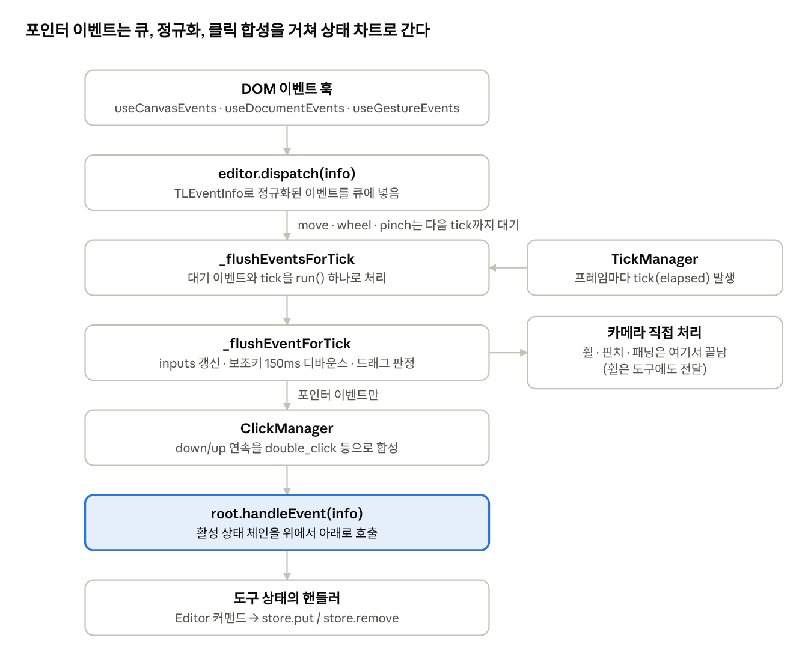

# 5장. 입력·이벤트·도구 상태 차트

사용자의 포인터·키보드·휠·핀치 입력은 모두 `TLEventInfo` 객체로 정규화되어 `editor.dispatch()`로 들어가고, Editor가 카메라·클릭·보조키를 처리한 뒤 <strong>계층형 상태 기계(statechart)</strong>에 전달합니다. 도구는 모두 이 상태 기계의 노드(`StateNode`)입니다. 이 장을 이해하면 "클릭 한 번이 어떻게 도형 선택이나 생성으로 이어지는가"를 추적할 수 있습니다.

<figure class="diagram">



<figcaption>이벤트 파이프라인 · DOM에서 스토어까지 7단계</figcaption>
</figure>

포인터 이동·휠·핀치는 프레임 단위로 묶이고, 나머지 이벤트는 즉시 처리됩니다. 휠·핀치·패닝은 Editor가 카메라를 직접 움직입니다.

## 5.1 DOM에서 Editor로

React 훅 세 개가 브라우저 이벤트를 수집합니다(`packages/editor/src/lib/hooks/`).

| 훅                  | 담당                                                                              |
|---------------------|-----------------------------------------------------------------------------------|
| `useCanvasEvents`   | 캔버스 요소의 pointerdown/move/up/cancel, 포인터 캡처, 드롭                       |
| `useDocumentEvents` | 컨테이너의 keydown/keyup, 디바이스 픽셀 비율 변화, 창 blur, Safari gesture 이벤트 |
| `useGestureEvents`  | wheel 정규화(`normalizeWheel`), 터치 두 손가락 핀치                               |

포인터 이벤트의 정규화는 다음과 같습니다.

- `getPointerInfo(editor, e)`가 화면 좌표(`point`, 필압은 z), 버튼, 보조키, `isPen`, `pointerId`를 담습니다.

- **target**은 `'canvas' | 'selection' | 'shape' | 'handle' | 'overlay'` 중 하나입니다. 캔버스 DOM에서 오는 이벤트는 모두 `'canvas'`입니다. 어떤 도형을 눌렀는지는 DOM 히트 테스트가 아니라 기하 히트 테스트로 select 도구가 나중에 판정합니다(5.6절).

- `pointerdown`에서 `setPointerCapture`를 해 컨테이너 밖으로 나가도 이벤트를 받습니다.

- `editor.wasEventAlreadyHandled(e)` / `markEventAsHandled(e)`로 UI 요소가 처리한 이벤트가 캔버스에 중복 전달되지 않게 합니다.

## 5.2 dispatch와 프레임 단위 배치

```ts
// Editor.ts
dispatch(info: TLEventInfo) {
  this._pendingEventsForNextTick.push(info)
  if (!((info.type === 'pointer' && info.name === 'pointer_move') || info.type === 'wheel' || info.type === 'pinch')) {
    this._flushEventsForTick(0)   // 나머지는 즉시
  }
  return this
}
```

포인터 이동은 초당 수백 번 들어올 수 있으므로 큐에 쌓아두고, `TickManager`가 다음 애니메이션 프레임에 `tick` 이벤트를 보낼 때 한꺼번에 처리합니다. `pointer_down`이나 키 입력은 순서가 중요하므로 즉시 flush하며, 이때 큐에 남아 있던 move도 함께 처리되어 순서가 보장됩니다.

`_flushEventsForTick(elapsed)`는 전체를 `this.run()`으로 감쌉니다. 그래서 한 프레임 동안의 이벤트가 만든 모든 스토어 변경은 하나의 트랜잭션이 되고, 렌더링은 프레임당 한 번입니다. 이벤트를 모두 처리한 뒤 `elapsed > 0`이면 상태 차트에 `tick` 이벤트(`onTick`)를 보내고 `scribbles.tick(elapsed)`를 호출합니다.

**TickManager**(`managers/TickManager/TickManager.ts`, 60줄)는 `throttleToNextFrame`으로 rAF 루프를 돌며 매 프레임 `emit('frame', elapsed)`와 `emit('tick', elapsed)`를 발생시킵니다. Editor 생성자가 `on('tick', _flushEventsForTick)`을 걸어 두었습니다.

## 5.3 \_flushEventForTick: Editor가 먼저 가로채는 것들

이벤트 하나를 처리하는 `_flushEventForTick(info)`(약 10987행~)의 순서입니다.

1.  크래시 상태면 무시. `emit('before-event', info)`.

2.  **misc 이벤트**(cancel/complete/interrupt): 드래그·패닝 상태를 정리하고 바로 `root.handleEvent`.

3.  **보조키 디바운스**: Shift·Alt·Ctrl·Meta가 눌리면 즉시 켜고, 떼면 150ms 뒤에 끕니다. 키를 살짝 일찍 떼도 스냅·비율 고정이 풀리지 않게 하는 장치입니다. Meta는 keyup 이벤트에서도 `metaKey`가 true로 오는 브라우저 동작 때문에 별도 처리합니다.

4.  **pinch**: 도구로 보내지 않고 Editor가 직접 카메라를 바꿉니다. 핀치 시작 시 `interrupt()`로 진행 중 인터랙션을 중단하고, 첫 손가락의 pointer_down이 바꾼 선택을 핀치 전 선택으로 되돌립니다.

5.  **wheel**: `cameraOptions.wheelBehavior`('zoom' \| 'pan' \| 'none')와 사용자의 `inputMode`(trackpad/mouse) 설정에 따라 줌 또는 팬을 합니다. Ctrl을 누르면 두 동작이 뒤바뀝니다. 줌은 포인터 아래 점이 고정되도록 `cx + x/zoom - x/cz` 식으로 카메라를 옮깁니다(6장).

6.  **pointer**: 핀치 중이면 무시합니다. 펜 모드에서는 펜이 아닌 입력(손바닥)을 상태를 건드리기 전에 버립니다. 그다음 `inputs.updateFromEvent(info)`.

    - `pointer_down`: 길게 누르기 타이머(`longPressDurationMs`) 시작, `isPointing = true`, 카메라 애니메이션 중단. 화면에 직접 대는 펜이면 펜 모드를 켭니다. 스타일러스 지우개 버튼이면 일시적으로 eraser 도구로, 가운데 버튼이면 패닝으로 전환합니다.

    - `pointer_move`: 패닝 중이면 카메라를 옮기고 끝냅니다. 아니면 원점과의 거리가 `dragDistanceSquared`(거친 포인터는 `coarseDragDistanceSquared`)를 넘을 때 `isDragging = true`로 바꿉니다. 도구는 이 플래그로 "클릭인가 드래그인가"를 판단합니다.

    - `pointer_up`: 패닝이었으면 포인터 속도로 `slideCamera`(관성 스크롤)를 합니다.

7.  **keyboard**: 눌린 키 집합을 갱신합니다. 스페이스바를 누르고 있으면 패닝 모드입니다(`spacebarPanning`).

8.  **포인터 이름 보정**: 가운데·오른쪽 버튼은 `middle_click`/`right_click`으로 이름을 바꿉니다. 오른쪽 클릭은 다른 도구에 있어도 select 도구로 바꿔 컨텍스트 메뉴가 올바른 선택을 보게 합니다(이슈 \#8828).

9.  **ClickManager**(5.4절)가 새 이벤트를 만들면 원본과 합성 이벤트를 차례로 상태 차트에 보냅니다.

10. `root.handleEvent(info)`, `emit('event', info)`. pointer_down이면 마지막에 열린 메뉴를 닫습니다.

## 5.4 InputsManager와 ClickManager

**InputsManager**는 입력 상태를 Atom으로 들고 있습니다. 도구 코드가 가장 많이 읽는 값들입니다.

- 점: `originScreenPoint`/`originPagePoint`(pointer_down 위치), `previous*`, `current*`, `pointerVelocity`

- 플래그: `isPointing`, `isDragging`, `isPinching`, `isPanning`, `isSpacebarPanning`, `isEditing`, `isPen`

- 보조키와 집합: `shiftKey`, `altKey`, `ctrlKey`, `metaKey`, `keys`, `buttons`

`updateFromEvent`는 화면 좌표를 `screenBounds`만큼 빼고, `page = screen / z - camera`로 페이지 좌표를 구합니다. 눈여겨볼 점은 **협업자가 있을 때만** `pointer` 레코드를 `history: 'ignore'`로 갱신한다는 것입니다. 혼자 작업할 때는 매 이동마다 스토어를 쓰지 않아 비용을 아낍니다. 포인터 속도는 `frame` 이벤트에서 갱신됩니다.

**ClickManager**는 작은 상태 기계(`idle → pendingDouble → pendingOverflow → overflow`)입니다. 연속 pointer_down이 `doubleClickDurationMs`(다음부터는 `multiClickDurationMs`) 안에 들어오면 `double_click` 이벤트를 합성하고, `phase: 'down' | 'up' | 'settle'`로 언제의 클릭인지 구분합니다. 트리플·쿼드러플 클릭도 같은 방식입니다. 포인터가 너무 멀리 움직이면 상태를 초기화합니다.

## 5.5 StateNode: 계층형 상태 기계

`StateNode`(`editor/tools/StateNode.ts`, 293줄)가 도구 시스템의 전부입니다.

```ts
class MyTool extends StateNode {
  static override id = 'my-tool'
  static override initial = 'idle'
  static override children = () => [Idle, Pointing, Dragging]
  static override isLockable = true          // 도구 잠금(생성 후에도 유지) 지원
  static override useCoalescedEvents = false // 펜의 합쳐진 이벤트 사용 여부
}
```

- **노드 종류**: root, branch(자식과 `initial`이 있음), leaf. 루트의 자식이 "도구"입니다. 예: `root.select.idle`, `root.geo.pointing`.

- **상태도 반응형**: `_isActive`와 `_current`는 Atom이고 `_path`는 Computed입니다. 그래서 `editor.getPath()`이나 `useValue(() => editor.isIn('select.idle'))`로 UI가 도구 상태에 반응합니다.

- **transition(id, info)**: `'select.resizing'`처럼 점 경로를 받아 단계별로 내려갑니다. 현재 자식과 다르면 이전 자식의 `exit(info, 새id)` 후 새 자식의 `enter(info, 이전id)`를 호출합니다. `info`는 상태 사이에 데이터를 넘기는 통로입니다.

- **enter**: `_isActive = true` 후 `onEnter`. 분기 노드면 `onEnter`가 다른 곳으로 전환하지 않았을 때만 `initial` 자식에 진입합니다.

- **exit**: `_isActive = false` 후 `onExit`, 그다음 현재 자식도 재귀적으로 나갑니다.

- **handleEvent(info)**: 자기 핸들러(`EVENT_NAME_MAP`으로 `pointer_down → onPointerDown` 등)를 먼저 호출하고, 여전히 활성이며 현재 자식이 그대로일 때만 자식에게 전달합니다. 부모가 이벤트를 보고 전환했다면 이전 자식은 그 이벤트를 받지 않습니다.

- **핸들러 목록**: `onWheel`, `onPointerDown/Move/Up`, `onLongPress`, `onDoubleClick`, `onRightClick`, `onMiddleClick`, `onKeyDown/Up/Repeat`, `onCancel`, `onComplete`, `onInterrupt`, `onTick`, `onEnter`, `onExit`.

- **도구 ID 마스크**: `setCurrentToolIdMask(id)`로 UI에 보이는 도구 ID를 바꿉니다. geo 도구가 '사각형', '타원' 같은 세부 도구처럼 보이는 데 씁니다.

- `trackPerformance`가 true인 도구는 진입·종료 시 PerformanceManager에 인터랙션 시작·끝을 알립니다.

Editor의 상태 차트 API: `setCurrentTool(id, info)`(= `root.transition`), `getCurrentTool()`, `getCurrentToolId()`, `getPath()`, `isIn('select.idle')`, `isInAny(...)`, `getStateDescendant('select.brushing')`.

**cancel / complete / interrupt**의 구분은 이렇습니다.

| 이벤트    | 발생 상황                             | 관례적 처리                         |
|-----------|---------------------------------------|-------------------------------------|
| cancel    | Esc 등 사용자가 취소                  | `bailToMark`로 되돌리고 이전 상태로 |
| complete  | undo 전, 포커스 상실 등 "지금 끝내라" | 현재 결과를 확정                    |
| interrupt | 핀치 시작, 펜 모드 전환 등 외부 간섭  | 안전하게 중단                       |

## 5.6 예제: select 도구의 클릭 한 번

select 도구(`packages/tldraw/src/lib/tools/SelectTool/`)의 자식 상태는 18개입니다. Idle, PointingCanvas, PointingShape, PointingSelection, PointingHandle, PointingResizeHandle, PointingRotateHandle, PointingCropHandle, PointingArrowLabel, Brushing, ScribbleBrushing, Translating, Resizing, Rotating, DraggingHandle, EditingShape, Crop, Cropping.

빈 캔버스가 아닌 도형을 클릭했을 때의 흐름입니다.

1.  DOM pointerdown → `dispatch({ type:'pointer', name:'pointer_down', target:'canvas', ... })` → 즉시 flush.

2.  `root.handleEvent` → `select.handleEvent` → `idle.onPointerDown(info)`.

3.  Idle은 `target === 'canvas'`일 때 스스로 판정합니다. 먼저 `overlays.getOverlayAtPoint`(핸들·리사이즈 핸들 등 오버레이), 그다음 `getHitShapeOnCanvasPointerDown`(기하 히트 테스트), 그다음 회전된 선택 경계 안인지 봅니다. 맞는 것이 있으면 `target`을 `'overlay' | 'shape' | 'selection'`로 바꿔 자기 자신을 다시 호출합니다.

4.  `target === 'shape'` → `parent.transition('pointing_shape', info)`.

5.  PointingShape는 포인터가 올라오면 선택을 확정합니다. 그 전에 `inputs.isDragging`이 되면 `translating`으로 전환합니다.

6.  Translating은 진입 시 히스토리 마크를 찍고, 매 move마다 `updateShapes`로 위치를 바꾸며, pointer_up에서 완료하고 Esc면 `bailToMark`합니다(9장).

DOM 히트 테스트 대신 기하 히트 테스트를 쓰므로, 속이 빈 도형의 내부, 테두리 근처의 마진, 프레임 라벨 같은 규칙을 렌더링과 무관하게 일관되게 적용할 수 있습니다(7장).

## 5.7 예제: 사각형 그리기(BaseBoxShapeTool)

`editor/tools/BaseBoxShapeTool`은 가장 단순한 생성 도구입니다(자식: Idle, Pointing).

```ts
// Pointing.onPointerMove (요약)
if (editor.inputs.getIsDragging()) {
  const creatingMarkId = editor.markHistoryStoppingPoint(`creating_box:${id}`)
  editor.createShapes([{ id, type: shapeType, x, y, props: { w: 1, h: 1 } }])
  editor.select(id)
  editor.setCurrentTool('select.resizing', {
    ...info, target: 'selection', handle: 'bottom_right',
    isCreating: true, creatingMarkId, onInteractionEnd: this.parent.id,
  })
}
```

생성 도구는 크기 1짜리 도형을 만들고 곧바로 **select 도구의 resizing 상태에 일을 넘깁니다.** 리사이즈 로직(스냅, 비율 고정, 반전)을 생성에도 그대로 재사용하는 것입니다. `onInteractionEnd`는 끝난 뒤 돌아올 도구를 알려주고, `isCreating`과 `creatingMarkId`는 취소 시 생성까지 되돌리게 합니다. 이 "만들고 넘기기" 패턴은 geo, frame, arrow, line 도구에서도 반복됩니다.

## 5.8 키보드와 포커스

- `useDocumentEvents`가 컨테이너의 keydown/keyup을 `key_down`/`key_up`/`key_repeat`로 dispatch합니다. 텍스트 입력이 키를 차지해야 하는 요소(`elementShouldCaptureKeys`)에서는 보내지 않습니다. 브라우저 줌 키(`=`, `-`, `0`), Tab, 방향키, Esc 등은 특별 처리합니다.

- 단축키는 Editor가 아니라 **UI 레이어**(`tldraw` 패키지의 액션·도구 정의에 붙은 `kbd`)가 처리합니다(12장). 상태 차트의 `onKeyDown`은 인터랙션 중 키(예: 드래그 중 Alt로 복제)를 다룹니다.

- **FocusManager**: `instance.isFocused`와 컨테이너 CSS 클래스(`tl-container__focused`)를 동기화합니다. 마우스 다운이면 포커스 링을 숨기고, Tab·화살표 키를 쓰면 보여줍니다. `autoFocus` 옵션, `focus()`, `blur()`(진행 중 인터랙션 complete 후 blur)를 제공합니다. 한 페이지에 에디터가 여러 개 있을 때 포커스된 에디터만 키 입력을 받게 하는 장치입니다.

## 5.9 이 장의 핵심 정리

- 모든 입력은 `TLEventInfo` → `dispatch` → (필요하면 다음 프레임까지 대기) → `run()` 안에서 처리됩니다.

- 카메라 제스처(휠·핀치·패닝)와 보조키·드래그 판정은 Editor가 직접 하고, 도구는 정제된 이벤트만 받습니다.

- 도구는 계층형 StateNode이며, 상태 자체가 Atom이라 UI가 반응할 수 있습니다.

- 도형 히트 판정은 DOM이 아닌 기하 연산이며, select의 Idle이 target을 다시 설정합니다.

- 생성 도구는 도형을 만든 직후 select 도구의 상태(resizing, dragging_handle 등)로 제어를 넘깁니다.

**다음 장**: 화면 좌표와 페이지 좌표, 카메라, 렌더링 파이프라인.
