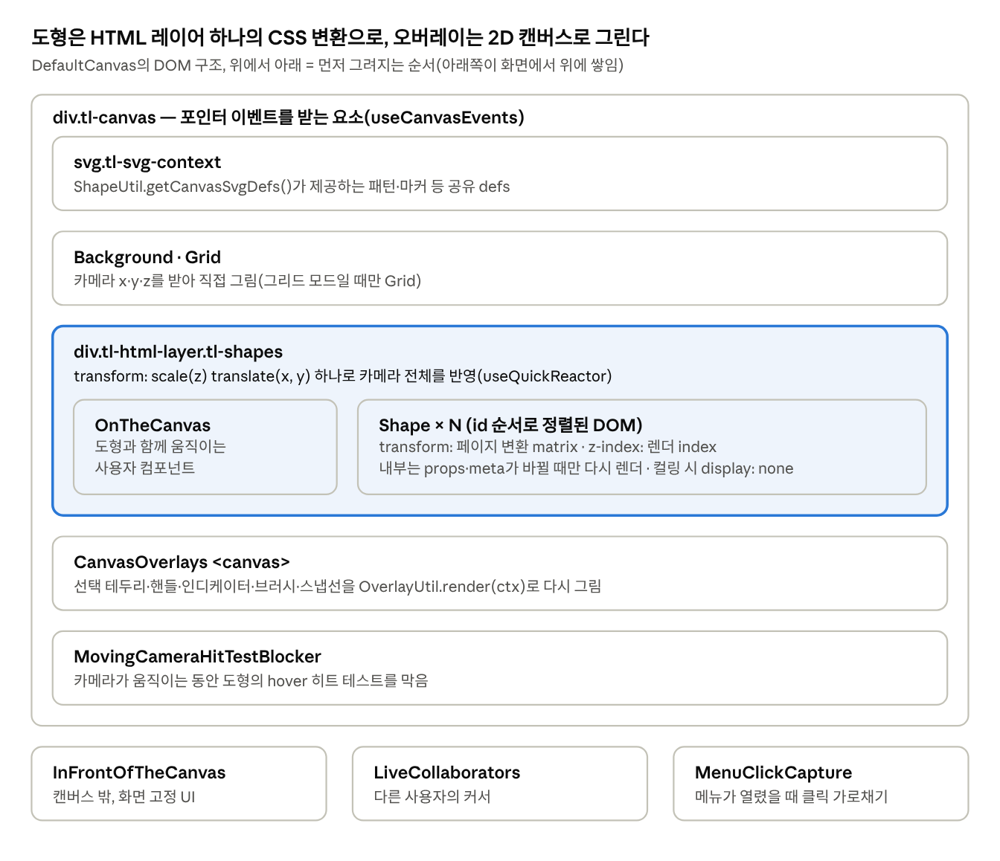

# 6장. 좌표·카메라·렌더링

tldraw는 도형을 SVG 하나나 Canvas에 통째로 그리지 않습니다. **도형마다 HTML div 하나**를 두고, 카메라는 그 div들을 담은 레이어의 CSS transform 하나로, 선택 테두리 같은 오버레이는 2D 캔버스로 그립니다. 이 장은 좌표계, 카메라 수학과 제약, 그리고 레코드 변경이 화면 픽셀이 되기까지의 렌더링 파이프라인을 다룹니다.

## 6.1 네 가지 좌표계

| 좌표계            | 기준                             | 언제 쓰나                    |
|-------------------|----------------------------------|------------------------------|
| 화면(screen)      | 브라우저 창 좌상단, CSS 픽셀     | DOM 이벤트의 clientX/Y       |
| 뷰포트(viewport)  | 에디터 컨테이너 좌상단           | 컨테이너 안 UI 배치          |
| 페이지(page)      | 무한 캔버스의 원점               | 도형 위치, 히트 테스트, 스냅 |
| 도형(shape/local) | 도형의 (x, y)와 회전이 만든 공간 | 지오메트리, 핸들, 렌더링     |

변환식(`Editor.ts`의 카메라 구역)은 카메라 `(cx, cy, z)`와 컨테이너 위치 `screenBounds`로 정해집니다.

```ts
screenToPage(p) = ((p.x - screenBounds.x) / z - cx,  (p.y - screenBounds.y) / z - cy)
pageToScreen(p) = ((p.x + cx) * z + screenBounds.x, (p.y + cy) * z + screenBounds.y)
pageToViewport(p) = ((p.x + cx) * z, (p.y + cy) * z)
getViewportPageBounds() = Box(-cx, -cy, w / z, h / z)
```

카메라의 x·y는 "화면 좌상단이 페이지의 어디인가"의 **음수**입니다. 카메라 (0, 0, 1)이면 페이지 원점이 화면 좌상단에 오고, 도형을 오른쪽으로 끌어오려면 cx를 키웁니다.

도형 공간은 4장의 `getShapePageTransform`(부모 체인의 행렬 곱)으로 연결됩니다. `getPointInShapeSpace(shape, pagePoint)`는 역행렬을 적용하고, `getPointInParentSpace`는 부모까지만 변환합니다.

**기하 원시타입**(`packages/editor/src/lib/primitives/`):

- `Vec`: x, y, z(필압 또는 줌)를 가진 벡터. 인스턴스 메서드는 제자리 변경, 정적 메서드(`Vec.Add`, `Vec.Dist2`, `Vec.Lrp` 등)는 새 값을 돌려줍니다.

- `Box`: 축 정렬 사각형. 합집합, 포함, 충돌, 모서리·변 중점, 리사이즈 핸들 계산(`Box.Resize`)을 제공합니다.

- `Mat`: 2D 아핀 행렬(a, b, c, d, e, f). `Compose`, `Inverse`, `applyToPoint(s)`, `rotation()`, `decompose()`, `toCssString()`.

- `intersect.ts`: 선분·원·다각형 교차. `easings.ts`: 애니메이션 이징 함수.

- `geometry/`: `Geometry2d`와 하위 클래스(7장).

## 6.2 카메라는 페이지별 레코드

`getCamera()`는 `camera:<현재페이지ID>` 레코드를 읽습니다. 단, 다른 사용자를 팔로우하며 잠긴 상태면 `getCameraForFollowing()`이 계산한 카메라를 덮어 돌려줍니다(6.6절).

모든 카메라 변경은 `_setCamera(point, opts)` 하나로 모입니다.

1.  `getConstrainedCamera(point, opts)`로 제약을 적용합니다(6.3절).

2.  값이 같으면 아무것도 하지 않습니다.

3.  `run(() => store.put([camera]), { history: 'ignore' })`. 카메라 이동은 undo 대상이 아닙니다.

4.  포인터의 화면 좌표는 그대로인데 페이지 좌표가 달라졌으므로 `updatePointer()`로 가상의 pointer_move를 보냅니다. 드래그 중 카메라가 움직여도(엣지 스크롤 등) 도형이 포인터를 따라가는 이유입니다.

5.  `_tickCameraState()`: `instance.cameraState`를 `'moving'`으로 바꾸고, `cameraMovingTimeoutMs` 동안 추가 이동이 없으면 tick에서 `'idle'`로 되돌립니다.

공개 API로는 `setCamera`(잠금 확인, 유한값 검사, 애니메이션 중단, 팔로우 해제 후 이동), `centerOnPoint`, `zoomIn`/`zoomOut`(`zoomSteps` 단계), `resetZoom`, `zoomToFit`, `zoomToSelection`, `zoomToBounds`, `zoomToUser`, `slideCamera`(관성 스크롤)가 있습니다.

**초점 고정 줌**: 포인터 아래 점 `(x, y)`(뷰포트 좌표)가 줌 전후 같은 페이지 점을 가리키려면 `x/z - cx`가 불변이어야 하므로, 새 카메라는 `cx' = cx + x/z' - x/z`입니다. 휠 줌과 핀치가 이 식을 씁니다(5장).

**애니메이션**: `opts.animation = { duration, easing }`이 있으면 `_animateToViewport`가 시작·끝 뷰포트 Box를 저장하고 `on('tick', _animateViewport)`로 매 프레임 네 모서리를 `lerp`합니다. 기본 이징은 `easeInOutCubic`입니다. 지속 시간은 사용자 설정의 애니메이션 속도(`user.getAnimationSpeed()`)로 나눠지며, 속도가 0(모션 감소)이면 애니메이션 없이 바로 이동합니다. 사용자 입력(휠, 핀치, pointer_down)이 오면 `stopCameraAnimation()`으로 즉시 멈춥니다.

## 6.3 카메라 제약

`TLCameraOptions`(`setCameraOptions`로 변경):

- `isLocked`: 카메라 고정. `force: true`가 아니면 모든 이동 무시.

- `wheelBehavior`: `'zoom' | 'pan' | 'none'`. `panSpeed`, `zoomSpeed`, `zoomSteps`(선택 가능한 줌 단계, 첫값이 최소·마지막 값이 최대).

- `constraints`: `bounds`(보여줘야 할 페이지 영역), `padding`, `origin`(0~1, 여유 공간에서 어디에 둘지), `initialZoom`/`baseZoom`(`'default' | 'fit-x' | 'fit-y' | 'fit-min' | 'fit-max'` 등), `behavior`(축별 설정 가능).

`getConstrainedCamera`의 동작:

1.  **줌 범위**: `[zoomSteps[0], zoomSteps.at(-1)]`. 제약이 있으면 `baseZoom`을 곱한 범위. 범위를 벗어나면 clamp하고, `preserveFocalPoint`로 요청된 초점이 유지되도록 x·y를 보정합니다.

2.  **위치(behavior)**: `fixed`는 항상 origin 위치, `contain`은 줌아웃하면 origin에 고정하고 줌인하면 경계 안에서만 이동, `inside`는 경계가 항상 뷰포트 안에 있게, `outside`는 경계가 뷰포트 밖으로 완전히 나가지 않게, `free`는 제한 없음.

3.  `reset: true`면 `initialZoom`과 origin 위치로 돌아갑니다.

이 기능으로 "한 장짜리 문서를 스크롤하는 뷰어"나 "슬라이드 크기에 맞춘 캔버스" 같은 앱을 만듭니다.

## 6.4 뷰포트 크기와 DPR

- `useScreenBounds(ref)`가 ResizeObserver와 스크롤·리사이즈 이벤트로 컨테이너 위치를 재고 `editor.updateViewportScreenBounds(elm)`을 호출합니다. 결과는 `instance.screenBounds`에 저장되며, `center` 인자가 true면 크기가 바뀌어도 중심을 유지합니다.

- `useDocumentEvents`가 `matchMedia`로 `devicePixelRatio` 변화를 감지해 `instance.devicePixelRatio`에 넣습니다. 캔버스 오버레이가 이 값으로 해상도를 맞춥니다.

- `useCoarsePointer`는 터치 기기를 감지해 `isCoarsePointer`를 설정합니다. 히트 마진(`coarseHitTestMargin`)과 핸들 반경이 커집니다.

## 6.5 렌더링 파이프라인

<figure class="diagram">



<figcaption>캔버스 렌더링 레이어 · DefaultCanvas DOM 구조</figcaption>
</figure>

카메라가 움직일 때 바뀌는 DOM은 HTML 레이어의 transform 하나와 오버레이 캔버스뿐입니다. 도형 div는 페이지 좌표로 배치되어 있어 건드리지 않습니다.

**1단계 — 무엇을 그릴지**: `editor.getRenderingShapes()`

- `getUnorderedRenderingShapes`가 현재 페이지의 도형 트리를 깊이 우선으로 돌며 `{ id, shape, util, index, backgroundIndex, opacity }`를 만듭니다.

- `index`(CSS z-index)는 순회 순서대로 증가합니다. 부모의 불투명도는 자식에 곱해집니다. 지우개로 지우는 중인 도형은 불투명도 0.32를 곱합니다.

- 숨겨진 도형(`getShapeVisibility` 옵션)은 건너뛰되 자식은 순회합니다.

- `providesBackgroundForChildren`인 도형(프레임 등)은 자식들의 배경 레이어가 자기 위에 오도록 `backgroundIndex` 범위를 내어줍니다.

- 결과는 **id로 정렬**됩니다. z-순서는 CSS z-index가 담당하므로, DOM 순서를 id로 고정해야 도형을 앞으로 가져오거나 부모를 바꿔도 React가 DOM 노드를 옮기지 않습니다. 도형이 많으면 이전 정렬 위치를 캐시해 재사용합니다.

**2단계 — 어디에 둘지**: `<Shape>` 컴포넌트(`components/Shape.tsx`)

- `useQuickReactor('set shape stuff')`가 페이지 변환 행렬을 `transform: matrix(...)`로, 지오메트리 경계를 width·height로, 클립 패스를 `clip-path`로 **DOM에 직접** 씁니다. React 렌더를 거치지 않고, 이전 값과 비교해 달라진 속성만 바꿉니다.

- `index`·`opacity`는 props로 받아 `useLayoutEffect`에서 설정합니다.

- 폰트: `fonts.getShapeFontFaces(id)`를 반응형으로 읽어 필요한 폰트를 요청합니다.

- 배경 컴포넌트(`util.backgroundComponent`)가 있으면 별도 래퍼를 `backgroundIndex`로 두고, 오류 경계로 도형 하나의 예외가 캔버스 전체를 깨지 않게 합니다.

**3단계 — 무엇을 그릴지(내용)**: `InnerShape`

```ts
export const InnerShape = memo(
  ({ shape, util }) => useStateTracking('InnerShape:' + shape.type,
    () => util.component(util.editor.store.unsafeGetWithoutCapture(shape.id)), [util, shape.id]),
  (prev, next) => areShapesContentEqual(prev.shape, next.shape) && prev.util === next.util
)
```

도형 내부(`util.component(shape)`)는 props나 meta가 바뀔 때만 다시 렌더됩니다. 도형을 끌어 옮기면 x·y만 바뀌므로 내부는 다시 그리지 않고 transform만 바뀝니다. `useStateTracking` 덕분에 컴포넌트가 렌더 중 읽은 다른 시그널(예: 테마, 줌)이 바뀌어도 다시 렌더됩니다.

**카메라 반영**: `DefaultCanvas`의 `useQuickReactor('position layers')`가 HTML 레이어에 `scale(z) translate(x + offset, y + offset)`를 씁니다(`getHtmlLayerTransform`). offset은 줌에 따라 아주 작게 더해지는 보정값입니다.

**오버레이**: `CanvasOverlays`는 `<canvas>` 하나에 `ctx.setTransform(dpr·z, 0, 0, dpr·z, dpr·z·cx, dpr·z·cy)`로 페이지 좌표계를 맞춘 뒤 활성 OverlayUtil들의 `render(ctx, overlays)`를 호출합니다. EffectScheduler로 구독하므로 카메라나 오버레이 입력이 바뀔 때만 다시 그립니다.

## 6.6 오버레이 시스템

`OverlayUtil`(`editor/overlays/OverlayUtil.ts`)은 "도형은 아니지만 캔버스 위에 보이고 때로는 클릭도 되는 것"을 정의합니다.

| 메서드                               | 역할                                                        |
|--------------------------------------|-------------------------------------------------------------|
| `isActive()`                         | 지금 그려야 하는가(반응형)                                  |
| `getOverlays()`                      | 그릴 항목 목록 `{ id, type, props }`                        |
| `getGeometry(overlay)`               | 히트 테스트용 지오메트리. 있으면 `getOverlayAtPoint`가 찾음 |
| `getCursor(overlay)`                 | 호버 시 커서                                                |
| `onPointerDown(overlay, info)`       | 직접 처리. false를 돌려주지 않으면 기본 라우팅 생략         |
| `render(ctx, overlays)`              | 2D 캔버스에 그리기                                          |
| `renderMinimap(ctx, overlays, zoom)` | 미니맵에 그리기                                             |

기본 오버레이(`packages/tldraw/src/lib/defaultOverlayUtils.ts`)는 13종입니다. 화살표 바인딩 힌트, 화살표 힌트, 브러시, 협업자 브러시·힌트·낙서·인디케이터, 낙서, **선택 전경(테두리·리사이즈·회전 핸들)**, 도형 핸들, 도형 인디케이터, 스냅 인디케이터, 줌 브러시입니다.

도형 인디케이터(호버·선택 시 외곽선)는 더 이상 SVG로 그리지 않습니다. `ShapeUtil.getIndicatorPath(shape)`가 `Path2D`(또는 클립 정보가 붙은 객체)를 돌려주면 오버레이가 캔버스에 그립니다. 예전 `indicator()` JSX는 deprecated입니다. 리사이즈 핸들·도형 핸들도 오버레이이므로, 5장에서 본 것처럼 select의 Idle이 `getOverlayAtPoint`로 먼저 확인합니다.

## 6.7 컬링과 공간 인덱스

**공간 인덱스**(`SpatialIndexManager`): rbush R-tree에 현재 페이지 도형의 페이지 경계를 넣습니다. Computed 안에서 `filterHistory('shape')`와 `filterHistory('binding')`의 diff를 받아 바뀐 도형과 그 자손·부모만 다시 넣습니다. 바인딩이 바뀌면 양 끝 도형도 표시합니다(화살표 경계가 바뀜 수 있음). 페이지가 바뀌거나, 히스토리가 끊기거나, 폰트가 로드되면(텍스트 크기 변화) 처음부터 `bulkLoad`합니다. `getShapeIdsInsideBounds(box)`, 브러시 선택, 히트 테스트 후보 추리기에 쓰입니다.

**컬링**:

1.  `notVisibleShapes`: 뷰포트 페이지 경계와 겹치지 않는 도형(R-tree 질의). `canCull`을 재정의한 도형은 그 판단을 따릅니다.

2.  `getCulledShapes()`: 위 집합에서 선택된 도형과 편집 중인 도형을 뺍니다. 내용이 같으면 이전 Set 참조를 그대로 돌려줍니다.

3.  `ShapeCullingProvider`: 컬링된 도형 div에 `display: none`만 설정합니다. **언마운트하지 않으므로** 화면에 다시 들어와도 React 마운트 비용이 없고, 이미지·비디오·임베드 상태도 유지됩니다.

## 6.8 성능 장치들

- **카메라 상태와 LOD**: 카메라가 움직이는 동안(`cameraState === 'moving'`) `MovingCameraHitTestBlocker`가 도형 hover 히트 테스트를 막습니다.

- **디바운스 줌**: `getDebouncedZoomLevel()`은 움직이는 동안 움직임 시작 시점의 줌을 돌려줍니다. 도형 수가 `debouncedZoomThreshold`를 넘으면 `getEfficientZoomLevel()`이 이 값을 써서, 줌에 따라 굵기가 바뀌는 도형들이 줌 제스처 동안 매 프레임 다시 렌더되지 않게 합니다.

- **텍스트 외곽선 LOD**: 줌이 `textShadowLod` 아래면 CSS 변수 `--tl-text-outline`을 꺼서 비싼 text-shadow를 없앱니다(Safari는 항상 끔).

- **DOM 직접 갱신**: transform·크기·클립·컬링 모두 `setStyleProperty`로 React를 거치지 않습니다.

- **프레임 배치**: 입력은 프레임당 한 번 `run`으로, 스토어 리스너는 프레임당 한 번 flush됩니다.

- **측정**: `PerformanceManager`는 `interaction-start/end`, `camera-start/end` 같은 이벤트를 FPS 등과 함께 내보냅니다. `PerformanceApiAdapter`는 이를 브라우저 Performance API(mark/measure)에 기록합니다.

- **저수준 디버깅**: `debugFlags`(`utils/debug-flags.ts`)로 지오메트리 그리기(`debugGeometry`), 도형 숨기기, SVG 내보내기 비교, 성능 측정을 켬 수 있습니다.

## 6.9 사용자 팔로우

`startFollowingUser(userId)`는 `instance.followingUserId`를 설정합니다. 여기서 현재 카메라가 상대방 presence에서 계산됩니다.

1.  `_getFollowingPresence`: 팔로우 대상이 또 다른 사람을 팔로우하면 체인을 따라 갑니다. 순환은 방문 목록으로 막습니다.

2.  `getViewportPageBoundsForFollowing`: 상대방의 presence에 담긴 카메라와 `screenBounds`로 상대방 뷰포트를 페이지 좌표로 구하고, 내 화면 비율로 그것을 포함하는 박스를 만듭니다.

3.  `getCameraForFollowing`이 그 박스에서 카메라를 역산합니다. 잠긴 팔로우 중에는 `getCamera()`가 이 값을 돌려줍니다.

4.  사용자가 휠·핀치 등으로 카메라를 직접 움직이면 `stopFollowingUser()`로 해제됩니다.

## 6.10 엣지 스크롤

`EdgeScrollManager`는 드래그 중 포인터가 뷰포트 가장자리 `edgeScrollDistance` 안에 들어오면 `edgeScrollDelay` 뒤에 카메라를 움직입니다. 속도는 가장자리에 가까울수록 빨라지고 `edgeScrollEaseDuration` 동안 서서히 가속합니다. 거친 포인터(터치)에서는 손가락 폭(`coarsePointerWidth`)만큼 감지 범위를 넓힙니다. 도구는 `onTick`에서 `editor.edgeScrollManager.updateEdgeScrolling(elapsed)`를 호출해 이 기능을 씁니다.

## 6.11 이 장의 핵심 정리

- 카메라는 페이지별 세션 레코드(x, y, z)이며 변경은 히스토리에 남지 않습니다.

- 모든 이동은 `getConstrainedCamera`를 거치며, 줌 범위와 경계 제약을 초점 보존하며 적용합니다.

- 도형은 페이지 좌표의 div이고 카메라는 레이어 transform 하나입니다. 내부 렌더는 내용이 바뀔 때만 일어납니다.

- 선택 테두리·핸들·인디케이터는 2D 캔버스 오버레이이며 히트 테스트도 가능합니다.

- 컬링은 언마운트가 아니라 `display: none`이고, R-tree가 화면 안 도형을 증분으로 알려줍니다.

**다음 장**: 도형을 정의하는 `ShapeUtil`과 지오메트리 시스템.
