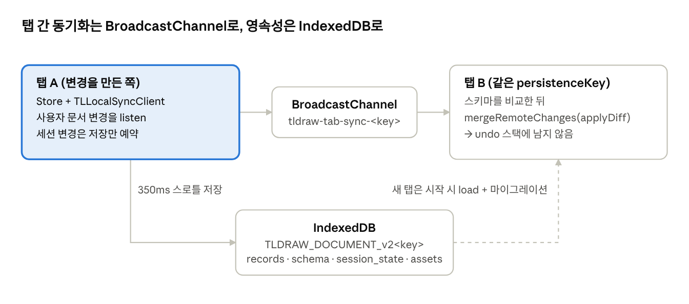

# 14장. 로컬 지속성, 탭 간 동기화, 스냅샷

`<Tldraw persistenceKey="my-doc" />` 한 줄이면 문서가 브라우저에 저장되고 같은 키를 쓰는 다른 탭과 실시간으로 동기화됩니다. 이것은 15–16장 동시 편집의 "축소판"입니다. 같은 `store.listen` → diff 전송 → `mergeRemoteChanges` 구조를 서버 없이 BroadcastChannel과 IndexedDB로 구현합니다.

<figure class="diagram">



<figcaption>로컬 지속성 · 탭 2개와 IndexedDB</figcaption>
</figure>

문서 변경은 다른 탭에 즉시 방송되고, 저장은 모아서 조금 늦게 됩니다. 다른 탭에서 받은 변경은 원격 변경으로 취급됩니다.

## 14.1 구성 요소

| 파일                                              | 역할                                                                                                            |
|---------------------------------------------------|-----------------------------------------------------------------------------------------------------------------|
| `editor/src/lib/hooks/useLocalStore.ts`           | `persistenceKey`가 있으면 `TLLocalSyncClient`를 만들고 `TLStoreWithStatus`(`loading` → `synced-local`)를 돌려줌 |
| `editor/src/lib/utils/sync/TLLocalSyncClient.ts`  | 탭 간 방송, IndexedDB 저장·로드, 스키마 충돌 처리                                                               |
| `editor/src/lib/utils/sync/LocalIndexedDb.ts`     | `idb` 라이브러리 기반 DB 래퍼                                                                                   |
| `editor/src/lib/config/TLSessionStateSnapshot.ts` | 탭별 세션 상태(카메라·선택 등)의 스냅샷                                                                         |
| `editor/src/lib/config/TLEditorSnapshot.ts`       | `getSnapshot` / `loadSnapshot` 공개 API                                                                         |

## 14.2 TLLocalSyncClient의 동작

**구독 두 개**(생성자):

```ts
store.listen(({ changes }) => {
  this.diffQueue.push(changes)
  this.channel.postMessage({ type: 'diff', storeId, changes, schema: this.serializedSchema })
  this.schedulePersist()
}, { source: 'user', scope: 'document' })   // 내가 만든 문서 변경만

store.listen(() => { this.diffQueue.push(UPDATE_INSTANCE_STATE); this.schedulePersist() },
  { scope: 'session' })                        // 세션 변경은 저장만
```

- `source: 'user'` 필터 덕분에 다른 탭에서 받은 변경(`'remote'`)을 다시 방송하는 에코가 생기지 않습니다(2.5절).

- 세션 상태는 탭마다 다르므로 방송하지 않습니다. 탭 A에서 줌해도 탭 B의 카메라는 그대로입니다.

- `pagehide`와 `visibilitychange`(hidden)에서 대기 중인 저장을 즉시 수행합니다.

**수신**(`handleMessage`):

1.  메시지에 담긴 상대 스키마에 대해 `getMigrationsSince`를 호출합니다.

2.  **상대가 더 최신**(우리가 모르는 마이그레이션): 초기화 5초 이내면 오류("다른 탭을 닫고 새로고침")를, 아니면 페이지를 새로고침합니다. 새 코드를 배포했을 때 낡은 탭이 스스로 갱신되는 메커니즘입니다.

3.  **우리가 더 최신**: `announce` 메시지로 우리 스키마를 알려 상대가 새로고침하게 하고, 전체 DB 쓰기를 예약합니다.

4.  **같으면**: `transact(() => store.mergeRemoteChanges(() => store.applyDiff(changes)))`.

**로드**(`connect`):

1.  같은 키로 진행 중인 이전 인스턴스의 종료 저장(`pendingFlushes`)을 기다립니다. React 개발 모드의 이중 마운트에서 데이터를 잃지 않기 위함입니다.

2.  로드하는 동안 도착한 방송 메시지는 버퍼에 모읍니다.

3.  `db.load({ sessionId })` → 레코드와 저장된 스키마로 `migrateStoreSnapshot` → document 타입만 골라 `mergeRemoteChanges(() => store.put(records, 'initialize'))`. 로드는 undo 스택에 남지 않습니다.

4.  세션 스냅샷을 스토어에 적용(`loadSessionStateSnapshotIntoStore`)합니다.

5.  버퍼의 메시지를 처리하고, `announce`를 보내고, `onLoad`를 호출합니다. 오래된 세션 행은 `pruneSessions`로 정리합니다.

**저장**(`doPersist`): `PERSIST_THROTTLE_MS = 350`마다 한 번, 큐의 diff를 `squashRecordDiffs`로 합쳐 `db.storeChanges`로 씁니다. 처음이거나 스키마가 바뀛거나 직전 쓰기가 실패했으면 `storeSnapshot`으로 전체를 덮어씁니다. 스토어가 손상 가능 상태(`isPossiblyCorrupted`, 4장의 크래시)이면 저장하지 않아 깨진 데이터가 디스크를 덮지 않게 합니다. 쓰기 실패 시에는 경고 후 새로고침하고, 재시도 간격은 10초입니다.

## 14.3 IndexedDB 구조

- DB 이름: `TLDRAW_DOCUMENT_v2` + persistenceKey. `openDB(이름, 4)`로 네 개 오브젝트 스토어를 만듭니다. records(ID→레코드), schema, session_state(세션 ID별), assets입니다.

- 예전 버전의 별도 에셋 DB(`TLDRAW_ASSET_STORE_v1`)는 열 때 옮겨서 합칩니다.

- `storeChanges`는 추가·갱신된 레코드를 put하고 삭제된 것을 delete하는 단일 트랜잭션입니다.

## 14.4 세션 상태와 TAB_ID

문서는 모든 탭이 공유하지만 "어느 페이지를 보고 있었고 카메라가 어디였는가"는 탭마다 다릅니다.

```ts
interface TLSessionStateSnapshot {
  version; currentPageId?; isFocusMode?; exportBackground?; isDebugMode?; isToolLocked?; isGridMode?
  pageStates?: Array<{ pageId; camera?: { x, y, z }; selectedShapeIds?; focusedGroupId? }>
}
```

- `createSessionStateSnapshotSignal(store)`은 instance·page state·camera 레코드에서 이 객체를 만드는 Computed입니다(`isEqual`로 변화가 있을 때만 갱신).

- 탭 ID(`TAB_ID`)는 `window`에 두고 sessionStorage에서 복원하지만, iOS가 아니면 로드 직후 sessionStorage에서 지웁니다. 탭을 복제했을 때 두 탭이 같은 세션 ID를 갖지 않게 하려는 것입니다. 새로고침 때는 unload 시점에 다시 써서 같은 탭이 자기 세션을 되찾습니다.

## 14.5 스냅샷 API

```ts
const { document, session } = getSnapshot(editor.store)   // TLEditorSnapshot
loadSnapshot(editor.store, { document, session }, { forceOverwriteSessionState })
```

- `getSnapshot`: `document`는 `store.getStoreSnapshot()`(document scope 레코드 + 스키마), `session`은 위 세션 스냅샷입니다.

- `loadSnapshot`: 예전 형식(`TLStoreSnapshot`, 세션 레코드가 섞인 것)도 받아 마이그레이션하고 document 타입만 골라냅니다. 자기 서버에 JSON으로 저장하는 앱은 이 두 함수와 `store.listen`만으로 지속성을 만들 수 있습니다.

- `.tldr` 파일(저장/열기)도 같은 직렬화 형식에 파일 헤더를 붙인 것입니다. `tldraw` 패키지의 `utils/tldr/file.ts`에 있습니다.

## 14.6 이 장의 핵심 정리

- 로컬 지속성은 "사용자 문서 diff를 방송 + 모아서 저장"이며, 받은 쪽은 `mergeRemoteChanges`로 적용합니다.

- 스키마 버전이 다른 탭은 새로고침으로 맞추고, 로드 시에는 항상 마이그레이션을 거칩니다.

- 문서와 탭별 세션 상태를 분리해 저장합니다.

**다음 장**: 같은 원리를 서버와 여러 사용자로 확장한 동시 편집.
