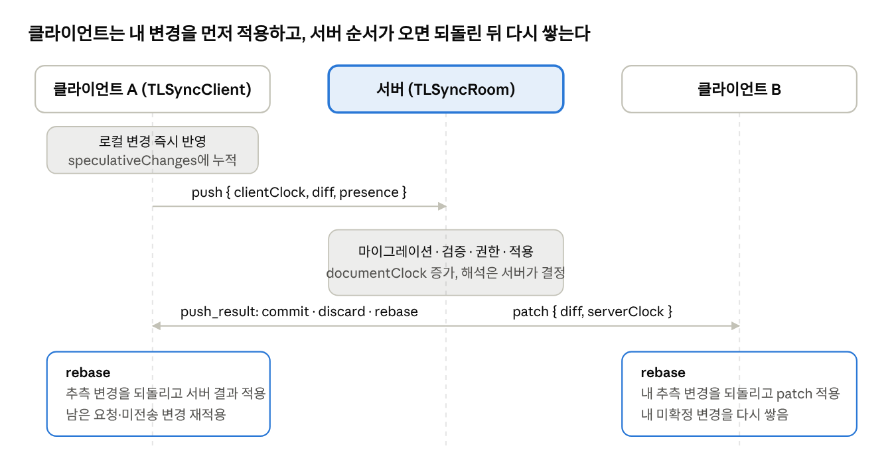

# 15장. 동시 편집 I — 프로토콜과 클라이언트

tldraw의 동시 편집(`@tldraw/sync-core`, `@tldraw/sync`)은 CRDT가 아닙니다. <strong>서버가 유일한 진실(authoritative server)</strong>이고, 클라이언트는 내 변경을 즉시 화면에 반영한 뒤(낙관적 적용) 서버가 정한 순서가 도착하면 그 위에 자기 변경을 다시 쌓는 **리베이스** 모델입니다. 단위는 레코드이고 충돌 해결은 속성 단위 "나중에 도착한 쓰기가 이긴다"입니다. 이 장은 메시지 포맷과 클라이언트(`TLSyncClient`)를, 16장은 서버를 다룹니다.

<figure class="diagram">



<figcaption>push 한 번의 수명 · 클라이언트 2, 서버 1</figcaption>
</figure>

서버 쪽 결과가 요청과 같으면 commit, 아무것도 반영되지 않았으면 discard, 다르게 반영되었으면 실제 결과(rebaseWithDiff)를 돌려줍니다. 다른 클라이언트는 같은 변경을 patch로 받습니다.

## 15.1 왜 CRDT가 아닌가

- tldraw의 상태는 이미 "ID로 주소를 갖는 레코드 집합"입니다. 도형을 동시에 편집하는 일은 대부분 서로 다른 레코드이거나 같은 레코드의 다른 속성이므로, 속성 단위 LWW(last-writer-wins)로 충분합니다.

- 분수 인덱스(3.4절), 선 도형의 점 사전(10.6절), 바인딩을 독립 레코드로 둔 것(8.7절) 등 데이터 모델 자체가 충돌을 줄이도록 설계되어 있습니다.

- 서버가 모든 쓰기를 검증·마이그레이션·권한 확인할 수 있습니다. 스키마 버전이 다른 클라이언트가 같은 방에 있어도 됩니다(16장).

- 대가는 서버 없이 P2P로 합칠 수 없고, 오프라인 편집은 재연결 때 "서버 상태 + 내 변경 재적용"으로만 합쳐집니다.

- 리치 텍스트는 JSON 통째가 속성이므로, 두 사람이 같은 텍스트 도형을 동시에 타이핑하면 한쪽이 이깁니다. 문자열 append op(15.3절)가 일부를 완화합니다.

## 15.2 프로토콜 메시지

`sync-core/src/lib/protocol.ts`, 프로토콜 버전 `TLSYNC_PROTOCOL_VERSION = 8`.

**클라이언트 → 서버**

| 메시지    | 필드                                                       | 의미                                              |
|-----------|------------------------------------------------------------|---------------------------------------------------|
| `connect` | connectRequestId, lastServerClock, protocolVersion, schema | 접속(재접속) 요청. 마지막으로 본 서버 시계를 보냄 |
| `push`    | clientClock, diff?, presence?                              | 내 문서 변경과 presence                           |
| `ping`    | —                                                          | 생존 확인                                         |

**서버 → 클라이언트**

| 메시지           | 필드                                                                                            | 의미                          |
|------------------|-------------------------------------------------------------------------------------------------|-------------------------------|
| `connect`        | hydrationType(`wipe_all`\|`wipe_presence`), diff, serverClock, schema, isReadonly, objectAccess | 접속 승인과 따라잡기 diff     |
| `patch`          | diff, serverClock                                                                               | 다른 사람의 변경              |
| `push_result`    | clientClock, serverClock, action(`commit`\|`discard`\|`{ rebaseWithDiff }`)                     | 내 push의 처리 결과           |
| `data`           | (patch \| push_result)\[\]                                                                      | 디바운스로 묶인 데이터 메시지 |
| `pong`, `custom` | — / data                                                                                        | 응답, 앱 정의 메시지          |

연결 오류는 WebSocket 종료 코드 `4099`와 이유(`TLSyncErrorCloseEventReason`)로 전달합니다. NOT_FOUND, FORBIDDEN, NOT_AUTHENTICATED, CLIENT_TOO_OLD, SERVER_TOO_OLD, INVALID_RECORD, RATE_LIMITED, ROOM_FULL, MESSAGE_TOO_LARGE, UNKNOWN_ERROR가 있습니다.

## 15.3 NetworkDiff: 네트워크용 diff

2장의 `RecordsDiff`는 이전·이후 레코드를 통째로 담아 크기가 큽니다. 네트워크로는 `NetworkDiff`(`diff.ts`)를 보냅니다.

```ts
type RecordOp = ['put', record] | ['patch', ObjectDiff] | ['remove']
interface NetworkDiff { [id: string]: RecordOp }

type ValueOp = ['put', value] | ['delete'] | ['append', items | text, offset] | ['patch', ObjectDiff]
interface ObjectDiff { [key: string]: ValueOp }
```

`getNetworkDiff(recordsDiff)`가 added → put, removed → remove, updated → `diffRecord(from, to)`로 바꿉니다. `diffRecord`의 규칙입니다.

- 최상위 키는 값 전체를 put합니다. 단, `props`와 `meta`는 한 단계 더 들어가 바뀐 필드만 patch합니다. 두 사람이 같은 도형의 `props.color`와 `props.w`를 동시에 바꿔도 둘 다 살아남는 이유입니다.

- **문자열**: 새 값이 이전 값으로 시작하면 `['append', 추가분, offset]`. 접미만 보내므로 긴 문자열(예: base64 펜 경로)에 점을 추가할 때 전송량이 작습니다.

- **배열**: 길이가 같고 바뀐 원소가 전체의 1/5 이하면 인덱스별 patch, 앞부분이 같고 뒤가 늘었으면 append, 그 외에는 통째 put.

- 중첩 객체는 재귀적으로 patch합니다.

`applyObjectDiff(object, diff)`는 구조 공유로 바뀐 부분만 새 객체를 만듭니다. 중요한 안전장치로, **append는 현재 길이가 offset과 같을 때만 적용**됩니다. 중간에 다른 변경이 끼어 길이가 달라졌다면 조용히 무시하고, 서버가 보내는 rebase/patch가 최종 값을 바로잡습니다. 프로토콜 7 이하 클라이언트가 있으면 문자열 append를 끄는 legacy 모드로 동작합니다.

## 15.4 TLSyncClient의 상태

`sync-core/src/lib/TLSyncClient.ts`(약 1,040줄)의 핵심 필드입니다.

| 필드                  | 의미                                                                      |
|-----------------------|---------------------------------------------------------------------------|
| `speculativeChanges`  | 서버가 아직 확정하지 않은 내 변경의 합(RecordsDiff). 화면에는 이미 적용됨 |
| `unsentChanges`       | 아직 보내지 않은 변경(`nextDiff`)과 presence(`nextPresence`)              |
| `pendingPushRequests` | 보냈지만 push_result를 못 받은 요청 큐(clientClock 순)                    |
| `incomingDiffBuffer`  | 서버에서 받아 아직 적용하지 않은 patch/push_result                        |
| `lastServerClock`     | 마지막으로 반영한 서버 시계. 재접속 시 전송                               |
| `clientClock`         | push마다 1 증가하는 요청 번호                                             |
| `isConnectedToRoom`   | connect 승인 여부                                                         |

## 15.5 보내기: push

```ts
store.listen(({ changes }) => this.push(changes), { source: 'user', scope: 'document' })

private push(change) {
  squashRecordDiffsMutable(this.speculativeChanges, [change])   // 추측 변경에 누적
  if (!this.isConnectedToRoom) return                          // 오프라인이면 여기서 멈춤
  squashRecordDiffsMutable(this.unsentChanges.nextDiff ??= empty, [change])
  this.sendUnsentChanges()                                     // fps 스로틀
}
```

- 14장과 같이 `source: 'user'`, `scope: 'document'` 변경만 보냅니다. 서버에서 받은 변경은 `mergeRemoteChanges` 안에서 적용되므로 되돌아 가지 않습니다.

- `sendUnsentChanges`는 `FpsScheduler`로 스로틀됩니다. 다른 사람이 있으면 30fps(`COLLABORATIVE_MODE_FPS`), 혼자면 1fps(`SOLO_MODE_FPS`)입니다. 혼자 여부는 `presenceMode`(다른 presence 레코드가 0개면 `'solo'`)로 판단합니다. 혼자일 때는 presence도 보내지 않습니다.

- 한 번에 보낼 때 모인 diff를 `getNetworkDiff`로 변환하고, presence는 직전에 보낸 것과 비교해 patch 또는 put을 만듭니다(`getPresenceOp`). 그리고 `clientClock`을 올리며 `pendingPushRequests`에 넣습니다.

- presence는 3장의 `createPresenceStateDerivation`이 만드는 Computed를 `react()`로 구독해 보냅니다. 커서 이동은 이 경로를 타며 문서 변경과 같은 push 메시지에 실립니다.

- 큰 메시지는 `chunk.ts`가 `0_`, `1_` 접두사를 붙여 약 256K 문자 단위로 나눕니다(1MB ÷ 문자당 최대 4바이트). 서로게이트 쌍은 자르지 않으며, 수신 측은 16M 문자·100,000 조각까지만 조립합니다.

## 15.6 받기와 리베이스

`handleServerEvent`는 patch·push_result·data를 `incomingDiffBuffer`에 넣고 `scheduleRebase()`(역시 fps 스로틀)를 부릅니다. 프레임당 한 번 모아서 처리하는 것입니다.

**rebase()**:

```ts
this.store.mergeRemoteChanges(() => {
  // 1. 내 추측 변경을 되돌린다 → 스토어는 "마지막으로 알던 서버 상태"
  this.store.applyDiff(reverseRecordsDiff(this.speculativeChanges), { runCallbacks: false })
  // 2. 서버가 정한 순서대로 적용
  for (const diff of diffs) {
    if (diff.type === 'patch') applyNetworkDiff(diff.diff)
    else /* push_result */ {
      // 큐 맨 앞 요청과 clientClock이 맞아야 함(아니면 예외 → 재접속)
      commit  → 그 요청의 diff를 확정 상태로 적용
      discard → 버림
      rebaseWithDiff → 서버가 실제로 만든 결과를 적용
    }
  }
  // 3. 아직 답을 못 받은 요청과 미전송 변경을 다시 쌓고, 그것을 새 추측 변경으로
  this.speculativeChanges = this.store.extractingChanges(() => { /* pending + unsent 재적용 */ })
})
this.lastServerClock = diffs.at(-1)?.serverClock
```

이 알고리즘은 Git의 rebase와 같습니다. 로컬 커밋을 떼어내고, upstream을 받고, 로컬 커밋을 다시 올립니다. 중요한 성질입니다.

- **수렴**: 모든 클라이언트는 결국 "서버 순서대로 적용한 상태"에 자기 미확정 변경을 얹은 상태가 되고, 미확정이 비면 서버와 같아집니다.

- **하나의 원자적 변경**: 전체가 `mergeRemoteChanges`(트랜잭션) 안이라 화면은 되돌린 중간 상태를 보여주지 않습니다. 값이 결국 같으면 레코드 Atom이 갱신되지 않아 리렌더도 없습니다.

- **콜백 제어**: 되돌리기는 `runCallbacks: false`로 사이드 이펙트를 끄고, 서버 변경과 재적용은 켜서 적용합니다. 사이드 이펙트가 만든 로컬 변경은 source가 `'user'`라 다시 push됩니다(2.6절).

- **undo와 무관**: 원격 변경은 `'remote'`라서 4장의 undo 스택에 들어가지 않습니다. 내 undo는 내 변경만 되돌리며, 그 결과도 새 push가 됩니다.

- **실패 복구**: 단계 중 예외가 나면 `ensureStoreIsUsable()` 후 `resetConnection()`으로 다시 접속해 서버 상태를 받습니다.

## 15.7 접속과 재접속

**connect**: 소켓이 online이 되면 `sendConnectMessage()`가 새 `connectRequestId`와 함께 스키마, 프로토콜 버전, `lastServerClock`을 보냅니다.

**didReconnect(connect 응답)**:

1.  오래된 요청 번호의 응답이면 무시합니다(연속 재접속 대비).

2.  추측 변경을 떼어내 보관합니다.

3.  `hydrationType`이 `wipe_all`이면 모든 document 레코드를 지우고 서버가 보낸 전체를 넣습니다. `wipe_presence`이면 추측 변경만 되돌리고 `lastServerClock` 이후 변경분만 적용합니다. presence는 항상 지우고 새로 받습니다.

4.  보관한 추측 변경을 다시 적용하고 그 결과를 `push`합니다. **오프라인 동안 한 편집이 여기서 서버로 올라갑니다.**

5.  `onAfterConnect`로 읽기 전용 여부를 알리고(`useSync`가 `instance.isReadonly`에 반영), presence를 보냅니다.

**resetConnection**: presence 레코드를 모두 지우고 대기 중 요청·버퍼를 비운 뒤 소켓을 재시작합니다. `speculativeChanges`는 유지하므로 내 편집은 잃지 않습니다. 대기 중 요청의 내용도 이미 추측 변경에 합쳐져 있기 때문입니다.

**생존 확인**: 5초(`PING_INTERVAL`)마다 ping을 보내고, 10초간 서버와 상호작용이 없으면서 ping도 10초 이상 응답이 없으면 연결을 재설정합니다.

**ClientWebSocketAdapter**(`ClientWebSocketAdapter.ts`): WebSocket을 감싸 `online/offline/error` 상태와 재접속을 관리합니다. 재접속 지연은 지수 백오프(배수 1.5)로, 탭이 보일 때 0.5–2초, 숨겨졌을 때 1초–5분 사이입니다. 탭이 다시 보이거나 네트워크가 돌아오면 즉시 다시 시도합니다. 서버가 4099로 닫으면 오류 상태가 되어 재접속하지 않습니다.

## 15.8 React 통합: useSync

`packages/sync/src/useSync.ts`가 위 조각을 조립합니다.

```tsx
const store = useSync({ uri: 'wss://example.com/connect/room-1', assets: myAssetStore, users })
return <Tldraw store={store} />
```

1.  `ClientWebSocketAdapter`를 만들며 URI에 `sessionId`(=14장의 `TAB_ID`)와 `storeId`를 쿼리로 붙입니다. 같은 탭이 재접속하면 서버가 같은 세션으로 알아봅니다.

2.  `createTLStore({ collaboration: { status, mode } })`: 연결 상태와 읽기 전용 모드 시그널을 스토어 props에 넣습니다. Editor는 이것을 `isReadonly`와 오프라인 표시에 씁니다(4.2절 16번).

3.  `createPresenceStateDerivation(currentUser, { getUserPresence })`로 presence Computed를, `presenceMode`는 다른 presence 수로 만듭니다.

4.  `new TLSyncClient({ store, socket, presence, presenceMode, onLoad, onSyncError, onAfterConnect })`.

5.  반환값은 `TLStoreWithStatus`: 처음 `loading`, connect 응답 후 `synced-remote`(+ `connectionStatus`), 오류면 `error`(`TLRemoteSyncError`).

`useSyncDemo`는 tldraw가 제공하는 데모 서버에 붙는 버전입니다. 에셋 업로드와 북마크 메타데이터 엔드포인트까지 연결되어 있어 프로토타이핑에 씁니다.

## 15.9 이 장의 핵심 정리

- 서버 권위 + 클라이언트 낙관적 적용 + 리베이스이며, 충돌은 레코드·props 필드 단위 LWW로 해결됩니다.

- 네트워크 diff는 props·meta 필드 단위 patch, 문자열·배열 append를 써서 작고, append는 offset이 맞을 때만 적용됩니다.

- 클라이언트는 추측 변경·대기 요청·미전송 변경 세 층을 유지하고, 프레임당 한 번 되돌리기-적용-재적용을 합니다.

- 재접속은 `lastServerClock` 이후 변경만 받고 내 미확정 변경을 다시 push합니다. 서버가 그 시점의 히스토리를 잃었으면 전체를 다시 받습니다.

**다음 장**: 서버 쪽 — 룸, 세션, 스토리지, 배포.
