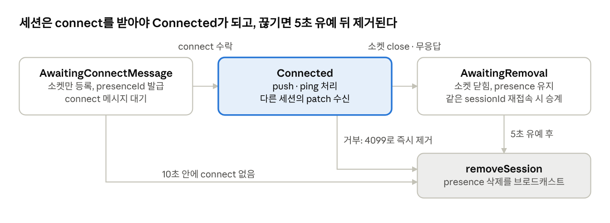

# 16장. 동시 편집 II: 서버

15장이 클라이언트(`TLSyncClient`)의 낙관적 적용과 리베이스를 다뤘다면, 이 장은 그 반대편 — 순서를 정하고 기록을 보관하는 **권위 있는 서버**를 다룹니다. 서버 코드는 모두 `packages/sync-core/src/lib`에 있고, 런타임 의존이 없는 순수 TypeScript라 Node, Bun, Cloudflare Workers 어디서든 돕니다. 소켓을 받아 넘겨주고 저장소를 꽂아 주는 일만 호스트가 하면 됩니다.

서버를 이해하는 열쇠는 세 가지입니다. (1) 모든 쓰기는 **동기 트랜잭션** 안에서 일어나고 문서 시계(`documentClock`)를 1씩 올린다, (2) 각 레코드는 마지막으로 바뀐 시계 값을, 삭제된 레코드는 **툼스톤**을 남겨서 "시계 N 이후 무엇이 바뀌었나"를 언제든 계산할 수 있다, (3) 클라이언트마다 스키마 버전이 달라도 서버는 자기 최신 스키마로 저장하고 보낼 때 세션별로 **다운 마이그레이션**한다.

## 16.1 서버 구성 요소

| 구성 요소                                              | 파일                         | 역할                                                                                     |
|--------------------------------------------------------|------------------------------|------------------------------------------------------------------------------------------|
| `TLSocketRoom`                                         | `TLSocketRoom.ts`            | 호스트용 공개 API. 소켓 이벤트 연결, 청크 조립, 세션 스냅샷, `updateStore`               |
| `TLSyncRoom`                                           | `TLSyncRoom.ts` (약 1,700줄) | 실제 룸 로직. 세션 관리, connect/push 처리, 브로드캐스트, 마이그레이션                   |
| `RoomSession`                                          | `RoomSession.ts`             | 세션 상태 3종의 판별 유니언과 타임아웃 상수                                              |
| `TLSyncStorage`                                        | `TLSyncStorage.ts`           | 저장소 인터페이스. 동기 트랜잭션 + 시계 + 변경 조회                                      |
| `InMemorySyncStorage`                                  | `InMemorySyncStorage.ts`     | signals `AtomMap` 기반 메모리 저장소, 툼스톤 정리 로직                                   |
| `SQLiteSyncStorage`                                    | `SQLiteSyncStorage.ts`       | SQLite 테이블 기반 영속 저장소                                                           |
| `NodeSqliteWrapper` / `DurableObjectSqliteSyncWrapper` | 같은 이름의 파일             | better-sqlite3·node:sqlite / Durable Object `ctx.storage`를 `TLSyncSqliteWrapper`로 감쌈 |
| `ServerSocketAdapter`                                  | `ServerSocketAdapter.ts`     | WebSocket을 `TLRoomSocket`(isOpen·sendMessage·close)으로 감쌈                            |
| `JsonChunkAssembler`                                   | `chunk.ts`                   | 클라이언트가 쪼개 보낸 큰 메시지를 다시 조립                                             |

계층은 단순합니다. 호스트 → `TLSocketRoom` → `TLSyncRoom` → `TLSyncStorage`. 호스트는 `TLSyncRoom`을 직접 만지지 않습니다.

## 16.2 TLSocketRoom: 호스트가 만지는 표면

```ts
const room = new TLSocketRoom({
  schema,                 // 생략 시 기본 tldraw 스키마
  storage,                // TLSyncStorage (없으면 InMemorySyncStorage)
  clientTimeout,          // 무응답 세션을 끊는 시간 (기본 20초)
  objectTypes,            // 객체 레인으로 보낼 레코드 타입 (16.9)
  authorizeRecord,        // 타입별 쓰기 권한 함수 (16.9)
  onSessionRemoved,       // (room, { sessionId, numSessionsRemaining, meta })
  onCommittedChanges,     // 클라이언트 push가 커밋된 뒤 diff 전달
  onSessionSnapshot,      // 5초 조용하면 세션 스냅샷 전달 (하이버네이션용)
  onBeforeSendMessage, onAfterReceiveMessage, log,
})

room.handleSocketConnect({ sessionId, socket, isReadonly, objectAccess, meta })
room.handleSocketMessage(sessionId, data, socket)
room.handleSocketClose(sessionId, socket)
room.handleSocketError(sessionId, socket)
```

- **소켓 인터페이스는 최소한**입니다(`WebSocketMinimal`). `addEventListener`가 있으면 `handleSocketConnect`가 직접 message/close/error를 구독하고, 없으면(Durable Object 하이버네이션처럼 이벤트가 클래스 메서드로 오는 환경) 호스트가 `handleSocketMessage` 등을 직접 부릅니다.

- **같은 `sessionId`의 새 소켓**이 오면 이전 소켓의 리스너를 떼고 교체합니다. 이후 옛 소켓에서 늦게 도착한 메시지·close는 `isSupersededSocket` 검사로 무시합니다. 그래서 세 번째 인자 `socket`을 넘기는 것이 안전합니다.

- **청크 조립**: 각 세션은 `JsonChunkAssembler`를 하나씩 가집니다. 클라이언트는 큰 push를 쪼개 보내는데(15장), 서버는 조립 중인 메시지가 1,600만 자(`MAX_ASSEMBLED_MESSAGE_CHARS`)나 청크 10만 개(`MAX_CHUNK_COUNT`)를 넘으면 `MESSAGE_TOO_LARGE`로 세션을 거부합니다. 끝 청크를 영영 보내지 않는 클라이언트가 메모리를 무한히 쌓지 못하게 하는 상한입니다.

- 메시지 하나를 처리할 때마다 `room.pruneSessions()`(1초 스로틀)를 부르고, `onSessionSnapshot`이 있으면 5초 디바운스로 세션 스냅샷을 예약합니다.

그 밖의 메서드: `getCurrentSnapshot()`/`loadSnapshot()`(룸 전체 교체 — 접속자 전원 재접속), `updateStore(fn)`(서버가 직접 레코드를 고침, 16.7), `getRecord`, `getSessions`, `getPresenceRecords`, `sendCustomMessage(sessionId, data)`(클라이언트 `onCustomMessageReceived`로 전달), `closeSession(sessionId, reason?)`, `close()`.

## 16.3 세션 수명

<figure class="diagram">



<figcaption>RoomSession 상태 기계 · 3상태와 제거</figcaption>
</figure>

`RoomSession`은 `state` 필드로 구분되는 유니언입니다. 상태마다 가진 필드가 다릅니다 — `Connected`만 `serializedSchema`, `requiresDownMigrations`, `lastInteractionTime`, `debounceTimer`, `outstandingDataMessages`를 갖습니다.

| 상수                        | 값       | 의미                                                                                       |
|-----------------------------|----------|--------------------------------------------------------------------------------------------|
| `SESSION_START_WAIT_TIME`   | 10,000ms | 소켓은 열렸는데 connect 메시지가 이 시간 안에 안 오면 제거                                 |
| `SESSION_IDLE_TIMEOUT`      | 20,000ms | `clientTimeout` 기본값. Connected 세션이 이 시간 동안 아무 메시지(ping 포함)도 없으면 취소 |
| `SESSION_REMOVAL_WAIT_TIME` | 5,000ms  | 취소(AwaitingRemoval) 후 실제 제거까지의 유예                                              |

- **취소와 제거는 다릅니다.** `cancelSession`은 소켓을 닫고 상태만 `AwaitingRemoval`로 바꿉니다. presence 레코드는 그대로 둡니다. 5초 뒤 `removeSession`이 presence를 지우고 다른 세션에 `deletes: [presenceId]` patch를 보냅니다. 그 사이 같은 `sessionId`로 재접속하면 `handleNewSession`이 `existing?.presenceId`를 물려받기 때문에, 짧은 네트워크 끊김에 다른 사람 화면에서 커서가 사라졌다 나타나는 깜빡임이 없습니다.

- <strong>거부(`rejectSession`)</strong>는 유예가 없습니다. 이유가 있으면 close code `4099`와 이유 문자열(123바이트 이내로 잘라 냄)로 소켓을 닫고 바로 제거합니다. 프로토콜 6 이하의 옛 클라이언트(`requiresLegacyRejection`)에는 close 대신 `incompatibility_error` 메시지를 보냅니다.

- `pruneSessions`는 메시지 처리 때와 `min(2000, clientTimeout/4)`ms 주기 타이머로 돌며 세 상태 각각의 시간 조건과 `socket.isOpen`을 검사합니다. `clientTimeout`이 `Infinity`면 주기 타이머를 아예 만들지 않습니다.

- 마지막 세션이 사라지면 `room_became_empty` 이벤트가 나고, `TLSocketRoom`은 `onSessionRemoved`의 `numSessionsRemaining === 0`으로 이를 호스트에 알립니다. 호스트는 보통 이때 룸을 닫고 메모리에서 내립니다.

## 16.4 connect 처리

`handleConnectRequest`가 하는 일을 순서대로 보면 서버의 버전 호환 전략이 다 드러납니다.

**1) 프로토콜 버전.** 현재 `TLSYNC_PROTOCOL_VERSION = 8`. 5는 6으로, 6은 레거시 거부 방식을 표시하고 7로, 7은 문자열 append 연산을 모르는 클라이언트이므로 `supportsStringAppend = false`를 표시하고 8로 올려 취급합니다. 그 뒤에도 낮으면 `CLIENT_TOO_OLD`, 높으면 `SERVER_TOO_OLD`로 거부합니다.

**2) 스키마 호환.** 클라이언트가 보낸 직렬화 스키마로 `schema.getMigrationsSince(clientSchema)`를 계산합니다.

```ts
const migrations = this.schema.getMigrationsSince(message.schema)
if (!migrations.ok) {                       // 클라이언트가 서버가 모르는 버전을 가짐
  this.rejectSession(id, this.getVersionMismatchReason(message.schema))
  return
}
if (migrations.value.some((m) => m.scope !== 'record' || !m.down)) {
  this.rejectSession(id, TLSyncErrorCloseEventReason.CLIENT_TOO_OLD)
  return
}
const requiresDownMigrations = migrations.value.length > 0
```

클라이언트가 서버보다 옛 스키마여도 받아 줄 수 있는 조건은 "그 사이 마이그레이션이 모두 레코드 단위이고 `down`을 가진다"입니다. store 단위 마이그레이션은 문서 전체를 다시 써야 하므로 레코드 하나씩 내려 보낼 수 없고, `down`이 없으면 옛 모양을 만들 수 없기 때문입니다. 반대로 클라이언트 쪽 시퀀스 버전이 더 높거나 서버가 모르는 시퀀스가 있으면 `SERVER_TOO_OLD` — 서버를 배포해야 한다는 신호입니다. 2장의 마이그레이션 설계(`down`을 꼭 쓸 이유)가 여기서 결실을 봅니다.

**3) 초기 상태 계산.** 저장소 트랜잭션 안에서:

```ts
this.broadcastChanges(txn)                                  // 밀린 외부 변경 먼저 처리
const docChanges = txn.getChangesSince(message.lastServerClock)
// 내 것을 뺀 모든 presence + 문서 변경분을 세션 스키마로 내려서
return {
  type: 'connect',
  hydrationType: docChanges?.wipeAll ? 'wipe_all' : 'wipe_presence',
  serverClock: txn.getClock(),
  diff: { ...presenceDiff.value, ...docDiff },
  schema: this.schema.serialize(),
  isReadonly, objectAccess, protocolVersion, connectRequestId,
}
```

- 처음 접속하는 클라이언트는 `lastServerClock = -1`(또는 아주 옛 값)을 보내므로 툼스톤 기록 시작점보다 앞이 되어 `wipe_all` — 전체 문서를 받고 로컬 문서를 갈아 끼웁니다.

- 재접속하는 클라이언트는 마지막으로 본 시계 이후의 변경과 툼스톤만 받습니다(`wipe_presence` — presence만 갈아 끼우고 문서는 diff 적용). 15장 `didReconnect`가 이 응답 위에 미확정 로컬 변경을 다시 쌓습니다.

- 클라이언트 시계가 서버 시계보다 크면(서버 저장소가 되돌려진 경우) `sinceClock = -1`로 바꿔 전체를 보냅니다.

- 응답을 만든 뒤에야 세션을 `Connected` 상태로 바꾸고 메시지를 보냅니다. 마이그레이션 실패로 `null`이 나오면 이미 거부되었으므로 아무것도 하지 않습니다.

## 16.5 push 처리: 서버가 결과를 정한다

`handlePushRequest`는 서버 코드의 심장입니다. 모든 일이 하나의 동기 저장소 트랜잭션 안에서 일어납니다.

1.  밀린 외부 변경을 먼저 브로드캐스트(`broadcastChanges(txn)`).

2.  **presence**가 있으면 저장소가 아니라 메모리의 `presenceStore`에 적용합니다. id와 typeName은 서버가 세션의 `presenceId`로 강제로 덮어씁니다 — 남의 presence를 위조할 수 없습니다.

3.  **문서 diff**의 각 연산을 처리합니다.

    - `Put`: 쓰기 권한(`canWrite`), 알려진 문서/객체 타입인지(아니면 `INVALID_RECORD`로 거부), 기존 레코드와 typeName이 같은지 검사 → 세션 스키마에서 서버 스키마로 **업 마이그레이션** → 권한 함수 → 기존 레코드가 있으면 diff 후 검증(`diffAndValidateRecord`), 없으면 `validateRecord` → 저장.

    - `Patch`: 대상이 없으면 무시. 세션 스키마가 서버와 같으면 그대로 적용·검증. 다르면 **현재 레코드를 세션 스키마로 내리고 → 패치 적용 → 다시 올린 뒤** diff를 계산합니다. 클라이언트가 보낸 패치는 클라이언트 스키마 기준 경로이기 때문입니다.

    - `Remove`: 대상이 없으면 무시, 권한 검사 후 삭제(툼스톤 기록).

4.  실제로 일어난 변경을 `NetworkDiff`로 모읍니다(`propagateOp`). 권한 거부·무변경 연산은 여기서 빠집니다.

그다음 보낸 사람에게 줄 답을 정합니다.

```ts
if (isEqual(result.docChanges.diffs?.networkDiff, message.diff)) {
  action = 'commit'                  // 보낸 그대로 반영됨
} else if (!result.docChanges.diffs?.networkDiff) {
  action = 'discard'                 // 아무것도 반영 안 됨
} else {
  action = { rebaseWithDiff: diff }  // 일부만, 혹은 다르게 반영됨 → 실제 결과를 보냄
}
```

이 세 갈래가 15장 클라이언트 리베이스의 짝입니다. `commit`이면 클라이언트는 추측 변경을 확정하고, `discard`면 되돌리고, `rebaseWithDiff`면 되돌린 뒤 서버가 실제로 만든 diff를 적용합니다. 예를 들어 읽기 전용 세션의 shape 이동, 권한 함수가 거부한 쓰기, 검증기가 정규화한 값, 이미 삭제된 레코드에 대한 패치가 모두 이 경로로 "자동 교정"됩니다. 서버가 클라이언트에게 오류를 던질 필요가 없다는 점이 설계의 핵심입니다.

마지막으로 `broadcastPatch`가 문서·presence 변경을 합쳐 **보낸 세션을 제외한** 모든 Connected 세션에 `patch`로 보냅니다. 세션마다 `requiresDownMigrations`면 diff를 그 세션 스키마로 내려 보내고(`migrateDiffOrRejectSession` — 실패하면 그 세션만 거부), 아니면 공용 `NetworkDiff`를 재사용합니다. `onPresenceChange`와 `onCommittedChanges`는 `queueMicrotask`로 트랜잭션 밖에서 부릅니다.

> 충돌 해결이 따로 없다는 점에 주목하세요. 서버는 도착 순서대로 연산을 적용할 뿐이고, 같은 레코드를 두 사람이 고치면 나중에 도착한 패치가 그 시점 레코드 위에 필드 단위로 적용됩니다. `ObjectDiff`가 필드 단위이므로 서로 다른 필드를 고친 경우는 둘 다 살아남습니다(15.3).

## 16.6 보내기: 데이터 메시지 묶음

`_unsafe_sendMessage`는 메시지 종류에 따라 다르게 보냅니다.

```ts
if (message.type !== 'patch' && message.type !== 'push_result') {
  if (message.type !== 'pong') this._flushDataMessages(sessionId)  // 순서 보존
  session.socket.sendMessage(message)
} else if (session.debounceTimer === null) {
  session.socket.sendMessage({ type: 'data', data: [message] })      // 첫 건은 즉시
  session.debounceTimer = setTimeout(flush, DATA_MESSAGE_DEBOUNCE_INTERVAL) // 1000/60ms
} else {
  session.outstandingDataMessages.push(message)                     // 창 안의 나머지는 모음
}
```

앞선 메시지(leading edge)는 지연 없이 나가고, 이후 약 16.7ms 창 안에 생긴 patch·push_result는 `data` 메시지 하나로 묶입니다. 여러 명이 동시에 드래그할 때 소켓 프레임 수를 프레임당 한 번 수준으로 제한합니다. connect·custom 같은 다른 메시지를 보내기 전에는 대기 중 데이터를 먼저 비워서 순서를 지킵니다. `pong`만 예외인데, 순서와 무관한 생존 확인이기 때문입니다.

## 16.7 저장소 계층과 툼스톤

```ts
interface TLSyncStorage<R> {
  transaction<T>(cb: (txn) => T, opts?: { id?: string; emitChanges?: 'always' | 'when-different' }):
    { documentClock: number; didChange: boolean; result: T; changes?: TLSyncForwardDiff<R> }
  getClock(): number
  onChange(cb: (arg: { id?: string; documentClock: number }) => void): () => void
  getSnapshot?(): RoomSnapshot
}
// txn: get / set / delete / entries / keys / values / getSchema / setSchema / getClock / getChangesSince
```

- **트랜잭션은 동기**입니다. 콜백이 Promise를 돌려주면 오류를 던집니다. 룸 로직 전체가 await 없이 한 번에 실행되므로 동시성 문제를 단일 스레드 이벤트 루프가 해결해 줍니다. SQLite 구현은 `sql.transaction()`(Node는 `BEGIN/COMMIT/ROLLBACK`, Durable Object는 `ctx.storage.transactionSync`)으로 원자성을 얻습니다.

- **시계**: 트랜잭션 안에서 첫 쓰기가 일어날 때 한 번만 `documentClock`을 1 올리고(`getNextClock`), 그 트랜잭션의 모든 쓰기는 같은 시계 값을 `lastChangedClock`으로 받습니다. 그래서 "시계 N 이후"는 "N번째 트랜잭션 이후"와 같습니다.

- **툼스톤**: `delete(id)`는 레코드를 지우고 `tombstones[id] = clock`을 남깁니다. 같은 id를 다시 `set`하면 툼스톤을 지웁니다.

- **getChangesSince(since)**: `lastChangedClock > since`인 레코드를 puts로, `clock > since`인 툼스톤을 deletes로 모읍니다. `since`가 `tombstoneHistoryStartsAtClock`보다 작으면 삭제 기록이 불완전하므로 `wipeAll: true`로 전체 레코드를 돌려줍니다.

**툼스톤 정리.** 툼스톤이 무한히 쌓이지 않도록 `MAX_TOMBSTONES = 5000`을 넘으면 오래된 것부터 지웁니다(1초 스로틀, leading 아님 — 요청 경로를 막지 않도록).

```ts
let cutoff = pruneBufferSize + tombstones.length - maxTombstones   // 1000개 여유를 더 지움
while (cutoff < tombstones.length &&
       tombstones[cutoff - 1]?.clock === tombstones[cutoff]?.clock) cutoff++  // 같은 시계는 통째로
newTombstoneHistoryStartsAtClock = tombstones[cutoff]?.clock ?? documentClock
```

한 번에 1,000개(`TOMBSTONE_PRUNE_BUFFER_SIZE`)를 더 지워 매번 정리가 일어나지 않게 하고, 같은 시계를 가진 툼스톤을 반쯤만 지우는 일이 없도록 경계를 밀어 냅니다. 기록 시작점이 올라가므로 그보다 오래 떨어져 있던 클라이언트는 재접속 때 `wipe_all`을 받습니다 — 정확성은 지키고 비용만 늘어나는 우아한 저하입니다.

**두 구현.**

|        | InMemorySyncStorage                                              | SQLiteSyncStorage                                                               |
|--------|------------------------------------------------------------------|---------------------------------------------------------------------------------|
| 레코드 | `AtomMap<id, { state, lastChangedClock }>` (문서용·객체용 두 개) | `documents`, `objects` 테이블 (`id`, `state BLOB`, `lastChangedClock` + 인덱스) |
| 툼스톤 | `AtomMap<id, clock>`                                             | `tombstones` 테이블 (`id`, `clock` + 인덱스)                                    |
| 메타   | `documentClock`, `tombstoneHistoryStartsAtClock`, `schema` atom  | `metadata` 테이블 한 줄 (+ `migrationVersion`)                                  |
| 영속성 | 없음. `getSnapshot()`을 호스트가 주기적으로 저장                 | 트랜잭션마다 디스크 반영                                                        |

SQLite 쪽 `getChangesSince`는 `WHERE lastChangedClock > ?` 인덱스 조회라 재접속 비용이 변경량에 비례합니다. 테이블 이름에는 접두사를 붙일 수 있어 한 DB에 여러 룸을 둘 수도 있고, 테이블 구조 자체는 `migrateSqliteSyncStorage`가 `migrationVersion`으로 관리합니다.

**외부 변경 반영.** 룸은 `storage.onChange`를 구독합니다. 자기 트랜잭션(`internalTxnId = 'TLSyncRoom.txn'`)이 아닌 변경이 생기면 `broadcastExternalStorageChanges`가 `getChangesSince(lastDocumentClock)`로 diff를 구해 전원에게 브로드캐스트하고, `wipeAll`이면 `forceAllReconnect`로 모두 끊어 다시 접속시킵니다. 덕분에 저장소를 직접 고쳐도 클라이언트가 따라옵니다. `TLSocketRoom.updateStore(fn)`이 바로 이 경로를 씁니다 — 현재 레코드 사본 위에서 `fn`(비동기 가능)을 돌린 뒤 결과를 한 트랜잭션으로 씁니다. 다만 `onCommittedChanges`는 클라이언트 push에만 불리므로, 서버 측 쓰기를 외부 시스템에 반영해야 한다면 그 경로를 따로 처리해야 합니다.

## 16.8 서버 측 스키마 마이그레이션

- 룸 생성자는 `storage.transaction(txn => schema.migrateStorage(txn))`로 저장된 문서를 현재 스키마로 끌어올립니다. 새 버전 서버를 배포하면 룸을 처음 여는 순간 데이터가 이주합니다.

- 그 뒤 서버 저장소는 항상 **서버의 최신 스키마**로만 존재합니다. 옛 클라이언트에게는 보낼 때 내리고(`down`), 받을 때 올립니다(`up`). 업 마이그레이션이 실패하면 `CLIENT_TOO_OLD`로 끊어 클라이언트가 새로고침하게 합니다.

- 클라이언트가 더 새 스키마라면(서버 배포가 늦은 경우) connect 단계에서 `SERVER_TOO_OLD`로 거부됩니다. 그래서 운영 순서는 언제나 **서버 먼저, 클라이언트 나중**입니다.

## 16.9 권한: 읽기 전용, 객체 레인, 레코드 권한 함수

권한 장치는 세 겹입니다.

1.  `isReadonly` — 세션 단위. 문서 레인 레코드의 모든 쓰기를 무시합니다(presence는 허용). 클라이언트도 connect 응답의 `isReadonly`를 보고 에디터를 읽기 전용으로 돌립니다.

2.  **객체 레인(`objectTypes` + `objectAccess`)** — 지정한 레코드 타입(예: 댓글)을 문서와 같은 소켓으로 동기화하되, 쓰기 권한은 `isReadonly`가 아니라 세션의 `objectAccess`(`'read' | 'write'`)로 판단합니다. "보기만 가능하지만 댓글은 달 수 있는" 세션이 이렇게 표현됩니다. 저장소도 문서·객체를 다른 맵/테이블에 나누어 두므로 문서 스냅샷(`.tldr` 다운로드 등)에 댓글이 섞이지 않습니다. 객체 타입은 반드시 스키마에 등록된 `document` 스코프여야 합니다(생성자에서 assert).

3.  `authorizeRecord` — 타입별 함수 맵. 클라이언트 push의 create/update/delete마다 서버 스키마로 올린 레코드를 받아 `null`이면 거부, 레코드를 돌려주면 허용합니다. **create에서 돌려준 레코드가 그대로 저장**되므로 작성자 id 같은 신원 필드를 세션 정보로 덮어쓰기(스탬핑)에 씁니다. 트랜잭션 안에서 동기로 돌기 때문에 I/O를 하면 안 되고, 던지면 거부로 처리합니다(fail closed). presence 타입에는 등록할 수 없습니다.

tldraw.com 서버(`apps/dotcom/sync-worker/src/authorizeFileRecord.ts`)의 실제 예입니다.

```ts
const authorizeShape: TLRecordAuthorizer<TLShape, SessionMeta> = ({ session, type, prev, next }) => {
  if (type === 'delete') return prev
  const before = type === 'create' ? null : getNoteAttribution(prev)
  const after = getNoteAttribution(next)            // note의 textLastEditedBy
  if (after !== before && after != null && after !== session.meta.userId) {
    if (type === 'update') return null                // 남의 이름으로 바꾸기 거부
    return { ...next, props: { ...next.props, textLastEditedBy: session.meta.userId } } // create는 재스탬핑
  }
  return next
}
export const authorizeFileRecord = {
  ...createCommentAuthorizers<SessionMeta>({ getUserId: (s) => s.meta.userId }),
  shape: authorizeShape,
}
```

세 장치 모두 거부된 연산을 조용히 빼고 진행하므로, 보낸 클라이언트는 16.5의 `rebaseWithDiff`/`discard`로 자기 화면을 서버 상태에 맞춰 되돌립니다.

## 16.10 배포 형태

**Node 서버** (`templates/simple-server-example`): Fastify + `@fastify/websocket`. 룸 id별로 `TLSocketRoom`을 `Map`에 캐시하고, 저장소는 룸마다 SQLite 파일(`NodeSqliteWrapper` + `SQLiteSyncStorage`)입니다. 마지막 세션이 나가면(`numSessionsRemaining === 0`) 룸과 DB를 닫습니다. 눈여겨볼 디테일: 룸을 준비하는 동안 들어온 메시지를 잃지 않도록 먼저 임시 리스너로 모아 두었다가, `handleSocketConnect` 뒤에 다시 emit합니다. `sessionId`는 클라이언트가 쿼리 파라미터로 보냅니다. 같은 템플릿에 에셋 업로드(`/uploads/:id`)와 북마크 unfurl 엔드포인트도 있습니다. `socketio-server-example`은 같은 구조를 Socket.IO 위에 올린 변형입니다.

**Cloudflare Durable Object** (`templates/sync-cloudflare/worker/TldrawDurableObject.ts`): 룸 하나 = DO 인스턴스 하나라서 "이 룸의 권위자는 한 곳"이라는 전제가 플랫폼 수준에서 보장됩니다.

- 저장소: `new SQLiteSyncStorage({ sql: new DurableObjectSqliteSyncWrapper(ctx.storage) })` — DO 내장 SQLite에 동기 트랜잭션으로 씁니다.

- **하이버네이션**: WebSocket Hibernation API를 쓰면 메시지가 없을 때 DO가 메모리에서 내려가도 소켓은 유지됩니다. 그래서 `onSessionSnapshot`으로 받은 세션 스냅샷(스키마, isReadonly, presence 등)을 `ws.serializeAttachment`에 넣어 두고, DO가 깨어나면 `ctx.getWebSockets()`의 attachment로 `handleSocketResume`을 불러 세션을 복원합니다(connect 재협상 없이 바로 Connected).

- `ctx.setWebSocketAutoResponse`로 `{"type":"ping"}` → `{"type":"pong"}`을 플랫폼이 대신 응답합니다. ping 때문에 DO가 깨어나지 않게 하는 장치인데, 대신 서버의 `lastInteractionTime`이 갱신되지 않으므로 `clientTimeout: Infinity`로 무응답 끊기를 끕니다. 연결 정리는 플랫폼의 `webSocketClose`/`webSocketError`가 맡습니다.

- 라우팅: `/api/connect/:roomId?sessionId=…`로 들어온 요청을 room id로 DO에 보냅니다. 에셋은 R2, unfurl은 워커 라우트가 담당합니다.

하이버네이션 중 끊긴 소켓에는 함정이 하나 있습니다. DO가 잠든 사이 끊긴 소켓은 깨어난 뒤 `ctx.getWebSockets()`에 포함되지 않아 룸에 복원되지 않은 상태입니다. 그래서 템플릿의 `handleWebSocketEnd`는 attachment에 스냅샷이 있는데 룸이 그 세션을 모르면 `handleSocketResume`으로 잠깐 되살린 뒤 `handleSocketClose`를 부릅니다. 이렇게 해야 다른 클라이언트에게 그 사용자의 presence 삭제가 브로드캐스트됩니다.

**tldraw.com** (`apps/dotcom/sync-worker/src/TLFileDurableObject.ts`)은 같은 골격 위에 인증, 읽기 전용 열기 모드, 댓글 객체 레인(`'comment-thread'`, `'comment'`, `'comment-reaction'` — Postgres로 별도 영속), 버전 기록, R2 스냅샷 등을 얹은 실서비스 구현입니다. `apps/bemo-worker`는 `useSyncDemo`가 붙는 데모 서버입니다.

## 16.11 이 장의 핵심 정리

- 서버는 **동기 트랜잭션 + 단조 증가 시계 + 툼스톤**으로 "N 이후 변경"을 계산하고, 이 하나의 연산으로 재접속, 외부 변경 브로드캐스트, 첫 로드를 모두 처리합니다. 툼스톤이 정리되어 기록이 끊기면 `wipe_all`로 안전하게 저하됩니다.

- push 결과는 commit / discard / rebaseWithDiff 셋 중 하나이고, 권한 거부·검증·마이그레이션의 차이가 모두 이 결과로 클라이언트에 교정됩니다. 별도의 충돌 해결 알고리즘은 없습니다.

- 스키마가 다른 클라이언트도 레코드 단위 `down` 마이그레이션만 있으면 같은 룸에 공존합니다. 배포 순서는 서버 먼저입니다.

- 세션은 connect 대기 10초, 무응답 20초, 제거 유예 5초의 상태 기계이며, 유예 덕분에 짧은 끊김에는 presence가 유지됩니다.

- 호스트의 책임은 소켓 전달, `sessionId`·권한·`meta` 결정, 저장소 선택, 룸 수명 관리뿐입니다.

**다음 장**: 댓글·mermaid·mentions 같은 부가 패키지와 저장소 안 앱들을 둘러봅니다.
