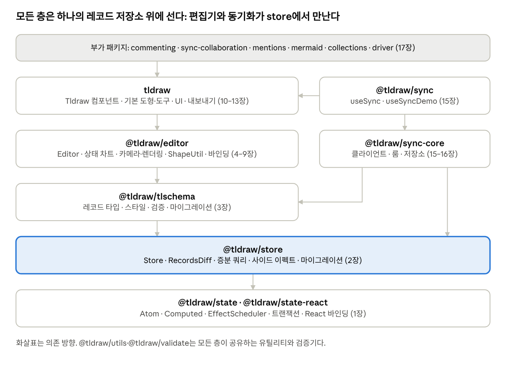

# tldraw 코드북

::: info 비공식 학습 자료
이 사이트는 tldraw 팀이 만든 공식 문서가 아닙니다. tldraw 소스코드를 읽으며 정리한 개인 학습용 가이드북입니다. 공식 문서는 [tldraw.dev](https://tldraw.dev)에서 볼 수 있습니다.
:::

## 이 코드북에 대해

[tldraw 저장소](https://github.com/tldraw/tldraw)의 소스를 직접 읽고, SDK가 어떤 원리로 동작하고 그 원리가 코드에서 어떻게 구현되어 있는지를 주제별로 정리한 책입니다. 주제 구성은 tldraw.dev 문서의 분류를 따랐고, 문서가 "무엇을 할 수 있는가"를 말한다면 이 책은 "왜 그렇게 동작하는가"를 말합니다.

- **대상 독자**: React와 TypeScript에 익숙한 숙련 프런트엔드 엔지니어. 반응형 상태, 상태 기계, 낙관적 업데이트 같은 일반 개념은 설명 없이 씁니다.

- **기준 커밋**: `main`의 `27b47cbf`(2026-11-04). 파일 경로는 저장소 루트 또는 `packages/<패키지>/src` 기준이고, 줄 번호는 버전에 따라 바뀌므로 함수·클래스 이름으로 찾으세요.

- **코드 발췌**: 핵심 흐름만 남기도록 주석·오류 처리·타입을 줄였습니다. 상수 값과 분기 조건은 원문 그대로입니다.

- **읽는 법**: 1–3장(state → store → tlschema)은 나머지 모든 장의 전제이므로 먼저 읽기를 권합니다. 에디터 동작이 궁금하면 그다음 4–9장, 동시 편집이 궁금하면 14–16장으로 가세요. 각 장은 "핵심 정리"로 끝나므로 복습용으로 그 부분만 읽어도 됩니다.

## 아키텍처 한눈에 보기

<figure class="diagram">

<figcaption>패키지 계층과 의존 · 장 번호 표시</figcaption>
</figure>

아래에서 위로 읽으면 됩니다. **state**는 값이 바뀌면 그 값을 읽은 계산만 다시 하는 반응성 엔진이고, **store**는 레코드마다 atom을 두고 모든 변경을 `RecordsDiff`로 기록하는 데이터베이스입니다. **tlschema**는 그 위에 tldraw의 레코드 타입·검증·마이그레이션을 정의합니다. **editor**는 이 저장소를 읽고 쓰는 명령들과, 그 상태로부터 파생되는 기하·화면을 관리하고, **tldraw**는 기본 도형·도구·UI를 얹어 완성품을 만듭니다.

데이터 흐름은 한 방향입니다. 입력 이벤트 → 도구의 상태 차트(StateNode) → `editor.run()` 안에서 store 쓰기 → 사이드 이펙트가 불변식을 맞춤 → `RecordsDiff`가 히스토리(되돌리기), 로컬 저장(IndexedDB·BroadcastChannel), 동기화 클라이언트로 각각 흘러감 → 반응형 파생값(기하·경계·컬링)이 필요한 만큼만 재계산 → 바뀐 도형 컴포넌트만 다시 렌더. 원격 변경도 같은 store로 들어오기 때문에(`source: 'remote'`) 렌더링과 파생값은 로컬과 원격을 구분하지 않습니다. 이 단순함이 tldraw 설계 전체를 관통하는 축입니다.

## 목차

**기반: 반응성과 데이터**

- [1장 반응성 엔진(state)](./chapters/01-state) — Atom·Computed·Effect, 전역 epoch와 지연 계산, 의존성 캡처, 히스토리 버퍼와 증분 계산, 트랜잭션, React 바인딩.

- [2장 레코드 저장소(store)](./chapters/02-store) — 레코드별 atom, `RecordsDiff`와 히스토리, 변경 출처와 범위, atomic 쓰기와 사이드 이펙트, 증분 인덱스, 스키마·마이그레이션.

- [3장 데이터 모델(tlschema)](./chapters/03-tlschema) — tldraw의 레코드 타입, 분수 인덱스, StyleProp, 리치 텍스트·획 압축, 검증 라이브러리, 무결성 검사, presence.

**에디터 동작**

- [4장 Editor 해부](./chapters/04-editor) — 생성자가 조립하는 것, `run()`과 히스토리 매니저, 에디터 불변식, 코어 캐시와 매니저들.

- [5장 입력·이벤트·상태 차트](./chapters/05-input-events) — DOM 이벤트에서 도구까지: dispatch 큐와 tick, 클릭 판별, StateNode 상태 차트.

- [6장 좌표·카메라·렌더링](./chapters/06-camera-rendering) — 좌표계, 카메라와 제약, HTML/SVG 레이어 렌더링, 컬링, 공간 인덱스, 캔버스 오버레이.

- [7장 도형 시스템(ShapeUtil)](./chapters/07-shapes) — ShapeUtil 계약, Geometry2d와 히트 테스트, 부모·그룹·프레임·마스크, 커스텀 도형 만들기.

- [8장 바인딩과 화살표](./chapters/08-bindings-arrows) — BindingUtil과 생명주기, 화살표 바인딩과 경로 계산(직선·곡선·꺾인 선).

- [9장 선택·변형·스냅](./chapters/09-selection-transform) — 선택과 브러시, 이동·크기 조절·회전, 스냅, 복제·정렬 명령.

**기본 제품 층**

- [10장 기본 도형과 도구](./chapters/10-default-shapes-tools) — geo·draw·text·note·line 등 기본 도형 구현과 기본 도구들의 상태 트리.

- [11장 텍스트·폰트](./chapters/11-text-fonts) — 텍스트 측정, TipTap 리치 텍스트 편집, FontManager.

- [12장 스타일·테마·UI](./chapters/12-styles-themes-ui) — 스타일 적용, 테마, UI 컨텍스트·액션·단축키·오버라이드, 컴포넌트 교체.

- [13장 에셋·클립보드·내보내기](./chapters/13-assets-clipboard-export) — 에셋 저장소, 외부 콘텐츠 핸들러, 복사·붙여넣기, SVG·PNG 내보내기.

**지속성과 동시 편집**

- [14장 로컬 지속성·탭 동기화](./chapters/14-persistence) — IndexedDB 저장, BroadcastChannel 탭 간 동기화, 세션 상태와 스냅샷.

- [15장 동시 편집 I: 프로토콜·클라이언트](./chapters/15-sync-client) — 서버 권위 + 낙관적 리베이스 모델, 프로토콜과 NetworkDiff, TLSyncClient, 재접속, useSync.

- [16장 동시 편집 II: 서버](./chapters/16-sync-server) — TLSocketRoom/TLSyncRoom, 세션 수명, push 처리, 저장소와 툼스톤, 스키마 호환, 권한, 배포 형태.

**주변**

- [17장 부가 패키지·앱](./chapters/17-extras) — 댓글(데이터·UI·서버 권한), 멘션, Mermaid, 컬렉션, Driver, 라이선스, 앱과 스타터 킷.

## 저장소 탐색 지도

| 경로                                                                           | 무엇이 있나                                                                                                          | 장      |
|--------------------------------------------------------------------------------|----------------------------------------------------------------------------------------------------------------------|---------|
| `packages/state/src/lib`                                                       | `Atom.ts`, `Computed.ts`, `EffectScheduler.ts`, `capture.ts`, `transactions.ts`, `HistoryBuffer.ts`                  | 1       |
| `packages/state-react/src/lib`                                                 | `useValue`, `track`, `useReactor`, `useQuickReactor`                                                                 | 1       |
| `packages/store/src/lib`                                                       | `Store.ts`, `AtomMap.ts`, `StoreQueries.ts`, `StoreSideEffects.ts`, `StoreSchema.ts`, `migrate.ts`, `RecordsDiff.ts` | 2       |
| `packages/tlschema/src`                                                        | `createTLSchema.ts`, `records/`, `shapes/`, `styles/`, `misc/`, `TLStore.ts`                                         | 3       |
| `packages/validate`, `packages/utils`                                          | 검증기 `T`, 분수 인덱스·재정렬, 공용 유틸                                                                            | 3       |
| `packages/editor/src/lib/editor/Editor.ts`                                     | Editor 클래스(약 11,000줄): 명령, 카메라, 히트 테스트, 이벤트                                                        | 4–9     |
| `packages/editor/src/lib/editor/{managers,derivations}`                        | 히스토리·스냅·공간 인덱스·클릭 등 매니저, 파생 계산                                                                  | 4–9     |
| `packages/editor/src/lib/editor/{shapes,bindings,tools,overlays}`              | ShapeUtil, BindingUtil, StateNode, OverlayUtil 기반 클래스                                                           | 5, 7, 8 |
| `packages/editor/src/lib/components`, `hooks`                                  | 캔버스·도형 컴포넌트, DOM 이벤트 훅                                                                                  | 5, 6    |
| `packages/editor/src/lib/utils/sync`, `config`                                 | 로컬 지속성(IndexedDB, BroadcastChannel), 스토어 생성                                                                | 14      |
| `packages/tldraw/src/lib/shapes`, `tools`, `bindings`                          | 기본 도형·도구·화살표 바인딩                                                                                         | 8–10    |
| `packages/tldraw/src/lib/ui`                                                   | UI 컨텍스트, 액션, 단축키, 클립보드                                                                                  | 12, 13  |
| `packages/tldraw/src/lib/utils/text`, `defaultExternalContentHandlers.ts`      | 리치 텍스트, 외부 콘텐츠 처리                                                                                        | 11, 13  |
| `packages/sync-core/src/lib`                                                   | `protocol.ts`, `diff.ts`, `TLSyncClient.ts`, `TLSyncRoom.ts`, `TLSocketRoom.ts`, `*SyncStorage.ts`                   | 15, 16  |
| `packages/sync/src`                                                            | `useSync.ts`, `useSyncDemo.ts`                                                                                       | 15      |
| `packages/{commenting,sync-collaboration,mentions,mermaid,collections,driver}` | 부가 패키지                                                                                                          | 17      |
| `templates/`                                                                   | 프레임워크 템플릿, 동기화 서버 예제, AI 스타터 킷                                                                    | 16, 17  |
| `apps/examples/src/examples`                                                   | 기능별 예제 수백 개. API가 실제로 어떻게 쓰이는지 보기 좋은 곳                                                       | 전체    |
| `apps/dotcom`                                                                  | tldraw.com 클라이언트와 워커들: SDK를 제품 규모로 쓰는 참고 구현                                                     | 16, 17  |

공개 패키지마다 루트에 있는 `api-report.api.md`는 api-extractor가 만든 공개 API 전체 목록이고, 저장소 루트의 `AGENTS.md`에는 패키지 구성과 개발 규칙이 정리되어 있습니다. 코드를 열기 전에 둘을 훑어 보면 길을 잃지 않습니다.
